# fin-ai-lab

[](https://github.com/devTomaszStoklosa/fin-ai-lab/actions/workflows/ci.yml)
[](LICENSE)


A hands-on AI engineering lab on financial-market data: LLM structured outputs, RAG, tool-using agents, multi-agent orchestration and fine-tuning. Every project here is measured by an eval suite before and after each change. One rule runs through all of it: **code computes the numbers, the model only explains them.**

> A learning project, not a product. Reports describe exposure and risk; nothing here is investment advice.

## What's inside

| Project | What it does | AI engineering focus | State |
|---|---|---|---|
| **Foundation** (`core/`) | LLM clients with token and cost tracking, versioned prompts, eval harness, throttled and cached HTTP | evals, observability, cost control | done |
| **P1 Portfolio X-Ray** (`portfolio_xray/`) | imports XTB and Bossa broker exports into one schema; when the format is unknown, the LLM proposes a parser config that is validated and approved before use; descriptive report | structured outputs, self-correction loop, guardrails, prompt-injection tests | done |
| **P2 Ask the filing** (`filings_rag/`) | answers questions about 10-K filings (SEC EDGAR) with citations, numeric questions routed to XBRL | RAG: chunking, hybrid search, reranking, contextual retrieval, refusals | done |
| **P3 Market Pulse** (`market_pulse/`) | daily market brief from FRED and NBP indicators; regime rule in code, MCP server with data tools | tool use, MCP, orchestrator-workers, run state, scheduling | done |
| **P4 Polish news classifier** (`news_classifier/`) | sentiment and event type of Polish financial headlines | teacher labeling, baselines, HerBERT fine-tune, Bielik LoRA, GGUF quantization, CPU inference | S1–S7 done, quantized model being retrained |
| **P5 Investment committee** (`investment_committee/`) | a supervisor with role sub-agents (fundamental, macro, sentiment, quant stress test) and a critic that rejects unsourced claims | multi-agent orchestration, evaluator-optimizer, memory, budgets, human-in-the-loop | code done, live A/B pending |
| **Portfolio web app** (`portfolio_webapp/`, `frontend/`) | FastAPI + React app on top of P1–P5: imports, daily value history, dividends and their tax, benchmark comparison, AI analysis | integrating the projects behind one API | in progress |

## Architecture

```mermaid
flowchart LR
  subgraph entry["Entry points"]
    direction TB
    web["Web app<br/>FastAPI + React"]
    cli["fin-ai-lab CLI"]
  end
  subgraph projects["Projects"]
    direction TB
    P1["P1 Portfolio X-Ray"]
    P2["P2 Filings RAG"]
    P3["P3 Market Pulse"]
    P4["P4 News classifier"]
    P5["P5 Investment committee<br/>(uses P1 and P3)"]
  end
  subgraph core["core: depends on nothing"]
    direction TB
    llm["llm: Gemini, Groq<br/>tokens, cost, traces"]
    evals["evals: suites, graders,<br/>baselines"]
    prompts["prompts: versioned"]
    http["http: throttled, cached"]
  end
  entry --> projects --> core
```



- Each project depends only on `core`, except P5, which composes P1 and P3, and the web app, which composes all of them.
- Every LLM call goes through `core.llm`. Each call is traced with tokens and cost, and a cost guard stops a run whose estimate would exceed the limit.
- External clients (LLM, OpenFIGI, NBP, FRED, Yahoo) are injected, so the test suite runs offline on fakes.
- Money is `Decimal` with an ISO 4217 currency, never `float`.

## Engineering principles

1. **Evals first.** A change to a prompt, model or pipeline is not done until its suite has run and been compared with the saved baseline.
2. **Code computes, the model explains.** Every number in a report comes from data or from code; the model never does financial arithmetic.
3. **External content is data, not instructions.** Broker files, filings and news are wrapped in tags in prompts, and dedicated eval cases try to inject instructions through them.
4. **Descriptive, never advisory.** Reports describe exposure and risk; a guardrail and an eval check that no report says buy, sell or increase.
5. **Zero cost.** Free API tiers only; throttling follows each model's per-minute and per-day limits.
6. **Raw SDK before frameworks.** No LangGraph or LlamaIndex until an ADR justifies one ([ADR-0002](docs/adr/0002-raw-sdk-before-frameworks.md)).

## Evals

Each suite is a `suite.yaml` plus a set of cases. The harness reports per-case regressions against a baseline pinned to the dataset version, together with cost, cache hits and p50/p95 latency ([docs/EVALS.md](docs/EVALS.md)). The golden sets are deliberately small: the point is to catch regressions and to compare variants, not to publish benchmarks.

| Suite | Checks | Baseline |
|---|---|---|
| `p1-import-accuracy` | broker rows mapped to the canonical schema | 4/4 |
| `p1-injection` | instructions hidden in imported files are ignored | 8/8 |
| `p1-report-faithfulness` | every number in the report matches computed metrics | 2/2 |
| `p1-no-advice` | no recommendation in reports (rule + LLM judge) | 2/2 |
| `p1-sector-accuracy` | sector classification by the LLM | 6/6 |
| `p2-retrieval-accuracy`, `p2-answer-accuracy` | right filing retrieved, correct answer or justified refusal | 4/4, 5/5 |
| `p3-regime-backtest`, `p3-trajectory` | regime rule on historical dates, agent calls the right tools | 4/4, set-F1 1.0 |
| `p4-classifier-*` | macro-F1 of five classifiers on the same human-labeled test set | see below |

P4 is the most instructive result. On a corpus of about a hundred headlines, the majority class, TF-IDF with logistic regression and a fine-tuned HerBERT all collapse to the most common class (macro-F1 0.21 for sentiment). A few-shot LLM wins (0.56 sentiment, 0.49 event type), at the cost of latency and API calls. The LoRA-tuned Bielik always returned valid JSON, but it also collapsed. Its quantized GGUF build produced echoes of the prompt, and the cause turned out to be a training bug, not llama.cpp: `max_length=512` cut every training example before the answer. The journal in [docs/LEARNING.md](docs/LEARNING.md) records each such step: hypothesis, measurement, cost, what worked, what did not.

Suites whose cases contain licensed data (press headlines, third-party FRED series) are built locally by a script and are not committed.

## Tech stack

- Python 3.12, uv, pytest, ruff, Typer, FastAPI, DuckDB, NumPy, scikit-learn
- Google Gemini (`google-genai`) as the main LLM, Groq as a second provider ([ADR-0007](docs/adr/0007-groq-secondary-llm-provider.md))
- HerBERT and Bielik (open weights) fine-tuned in Colab; llama.cpp for CPU inference
- React 19, TypeScript, Vite
- Data: SEC EDGAR, FRED, NBP, OpenFIGI, Yahoo Finance, RSS ([docs/DATA-SOURCES.md](docs/DATA-SOURCES.md), with the license of each source)

## Getting started

```bash
uv sync --extra portfolio --extra rag --extra pulse --extra ml --extra groq --extra ui
cp .env.example .env          # API keys: Gemini, Groq, FRED (free tiers)
uv run pytest -q              # offline, on fakes and synthetic fixtures
uv run fin-ai-lab --help      # portfolio, filings-rag, market-pulse, news-classifier, investment-committee, eval, web
```

Each project's dependencies are a separate extra, so a plain `uv sync` installs only the core, and tests of missing extras are skipped. `herbert` and `quantized` (PyTorch, llama.cpp) are needed only for local P4 inference.

Web app: `uv run fin-ai-lab web` for the API, then `npm install` and `npm run dev` in `frontend/`.

An eval run: `uv run fin-ai-lab eval p1-injection`.

## How this repo is built

The code is written with [Claude Code](https://claude.com/claude-code). I own the requirements, the decisions and the review; Claude writes most of the code.

- Each project goes through a story, a spec and a design ([RoleKit](docs/specs/) artifacts) before any code, and every larger decision has an ADR in [docs/adr/](docs/adr/).
- Every change is an issue, a branch and a reviewed pull request.
- [CLAUDE.md](CLAUDE.md) is the working agreement the agent follows: hard rules, conventions, where to look.

The detailed documentation is in Polish, the language I learn in; code, prompts and commits are in English.

| Document | Contents |
|---|---|
| [docs/ROADMAP.md](docs/ROADMAP.md) | projects, slices, order, state |
| [docs/ARCHITECTURE.md](docs/ARCHITECTURE.md) | repo layout, shared modules, flows |
| [docs/EVALS.md](docs/EVALS.md) | eval methodology and file formats |
| [docs/LEARNING.md](docs/LEARNING.md) | learning journal, one entry per finished slice |
| [docs/LLM-API.md](docs/LLM-API.md), [docs/LLM-API-GROQ.md](docs/LLM-API-GROQ.md) | models, limits, costs, pitfalls |
| [docs/DATA-SOURCES.md](docs/DATA-SOURCES.md) | data sources, licenses, limits |
| [docs/ENVIRONMENT.md](docs/ENVIRONMENT.md) | the development machine (no AVX2, no GPU) and its workarounds |

## History

The development history up to 2026-10-19 (about 250 commits and 160 pull requests) lives in a private repository, because it contains data from my real broker accounts. This repository starts from that state; all later work happens here. Issue and pull request numbers mentioned in the docs (such as #142) refer to that archive; its open issues were moved here as #1–#9.

## License

MIT, see [LICENSE](LICENSE).
