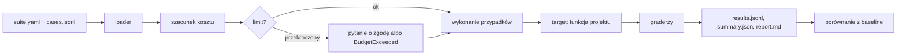

# Moduł `core`

> Stan na 2026-10-23, commit `d0c43b4`. Opis sprawdzony w kodzie `src/fin_ai_lab/core/`.

## Odpowiedzialność

`core` to fundament wspólny dla wszystkich projektów. Nie zależy od żadnego projektu (pilnuje tego `tests/test_architecture.py`). Daje pięć rzeczy:

1. klienta LLM (Gemini i Groq) z liczeniem tokenów, kosztu i zapisem śladów,
2. rejestr promptów trzymanych w plikach z numerem wersji,
3. harness evali: suity, graderzy, baseline, raport,
4. klienta HTTP z ograniczaniem tempa, ponawianiem i cache na dysku,
5. ustawienia z `.env` i małe narzędzia (kursy NBP, wyjątki).

```
core/
├── config.py            Settings (.env)
├── errors.py            wyjątki domenowe
├── llm/                 klienci LLM, cennik, ślad (trace), atrapy
├── prompts/registry.py  PromptRegistry
├── evals/               runner, loader, graderzy, raport, cache
├── http/client.py       ThrottledHttpClient
└── data/nbp.py          kursy walut NBP (współdzielone)
```

## Ustawienia: `config.py`

`Settings` (pydantic-settings) czyta plik `.env` z katalogu, w którym uruchamiasz program. Nieznane zmienne są ignorowane.

| Zmienna | Do czego | Gdy brak |
|---|---|---|
| `GEMINI_API_KEY` | główny LLM i embeddingi | `ConfigError("GEMINI_API_KEY")` przy `require_gemini_api_key()` |
| `GROQ_API_KEY` | drugi dostawca LLM (ADR 0007) | `ConfigError` przy `require_groq_api_key()` |
| `SEC_USER_AGENT` | wymagany przez SEC EDGAR (P2) | `ConfigError` |
| `FRED_API_KEY` | szeregi FRED (P3) | `ConfigError` |
| `NTFY_TOPIC` | powiadomienia push (P3) | `ConfigError` |
| `FIN_AI_LAB_MAX_RUN_COST_USD` | limit kosztu jednego przebiegu, domyślnie `0` | — |

Klucze są opcjonalne w modelu, a wymaga ich dopiero metoda `require_*`. Dzięki temu tryb offline (atrapy) działa bez żadnego klucza.

## Klienci LLM: `llm/`

### Kontrakt

Wszystko opiera się na protokole `LlmClient` z jedną metodą `async complete(LlmRequest) -> LlmResult` (`llm/client.py`).

| `LlmRequest` | Znaczenie |
|---|---|
| `model` | identyfikator modelu; musi być w `PRICES`, inaczej `UnknownModelError` |
| `messages` | lista `{"role", "text"}` |
| `system_instruction` | instrukcja systemowa |
| `max_output_tokens` | domyślnie 16 000 |
| `response_schema` | klasa pydantic; włącza odpowiedź JSON i walidację |
| `tools` | zwykłe funkcje Pythona, które model może wywołać |
| `prompt_id`, `prompt_version` | trafiają do śladu |

| `LlmResult` | Znaczenie |
|---|---|
| `text`, `parsed` | surowy tekst i obiekt zgodny ze schematem |
| `finish_reason`, `incomplete` | `incomplete = True`, gdy odpowiedź nie skończyła się normalnie (np. ucięta limitem tokenów) |
| `usage`, `cost_usd`, `latency_ms` | tokeny, koszt (z cennika), czas |
| `trace_id`, `span_id` | do powiązania ze śladem |
| `tool_calls` | nazwy narzędzi wywołanych przez model, po kolei |

Odpowiedź niezgodna ze schematem to `ResponseValidationError` z surowym tekstem w `raw_response`. Pętla naprawy (ponowne pytanie modelu) jest po stronie aplikacji, nie klienta.

`CostTrackingLlmClient` to protokół klienta, który dodatkowo trzyma `total_cost_usd`. Używa go runner evali do liczenia kosztu przypadku.

### `GeminiLlmClient`

- Używa SDK `google-genai`. Funkcje podane w `tools` wywołuje automatycznie sam SDK (pętla "model wybiera narzędzie, SDK je woła, model odpowiada") w ramach jednego `complete()`.
- **Ograniczanie tempa:** minimalny odstęp między żądaniami HTTP, domyślnie 12 s (`60 / 5`, czyli 5 żądań na minutę, limit darmowego tieru `gemini-3.6-flash`). Hak na żądaniu httpx działa przed każdym żądaniem, także przy ponowieniach SDK i kolejnych turach wywołań narzędzi, bo każde liczy się do limitu.
- **Ponowienia:** 2 próby, tylko dla 500/502/503/504. Kod 429 celowo nie jest ponawiany (dzienny limit nie znika po kilku sekundach).
- **Licznik prób** (`attempts` w śladzie) liczy faktycznie wysłane żądania HTTP, żeby ślad pokazywał zużycie dziennego limitu.
- **Znane ograniczenie:** przy wielu wywołaniach narzędzi w jednym `complete()` SDK zwraca zużycie tylko z ostatniej tury, więc `cost_usd` jest zaniżony (świadoma decyzja, opisana w kodzie).

### `GroqLlmClient`

Druga implementacja tego samego protokołu ([ADR-0007](../adr/0007-groq-secondary-llm-provider.md)) z niezależnym darmowym limitem. Groq nie ma automatycznego wywoływania narzędzi, więc klient sam prowadzi pętlę, maksymalnie `MAX_TOOL_ITERATIONS = 8` obrotów. Dla `response_schema` włącza tryb JSON i dopisuje do instrukcji systemowej zdanie z słowem "JSON" (Groq zwraca błąd 400 bez niego). Schemat narzędzia buduje z sygnatury funkcji (typy `str/int/float/bool`, reszta jako `string`).

### Embeddingi: `llm/embeddings.py`

`GeminiEmbeddingClient.embed(texts, model)` dzieli teksty na paczki po 20 (`MAX_BATCH_SIZE`) i po każdej czeka `liczba_tekstów × 0,75 s`, bo limit darmowego tieru liczy teksty, nie wywołania. API nie zwraca liczby tokenów, więc koszt jest szacowany jako `znaki / 4`. Wynik: `EmbeddingResult(vectors, cost_usd)`.

### Cennik: `llm/pricing.py`

Słownik `PRICES: model -> ModelPrice` z progami zależnymi od długości wejścia i datą migawki `PRICES_AS_OF = 2026-09-16`. Modele w cenniku: `gemini-2.5-pro`, `gemini-2.5-flash`, `gemini-2.5-flash-lite`, `gemini-3.6-flash`, `gemini-embedding-2`, `openai/gpt-oss-120b`, `openai/gpt-oss-20b`. Nieznany model to wyjątek, nigdy koszt zero.

Konto nie ma podpiętego billingu, więc realny koszt to zawsze 0 USD. Cennik służy jako **bezpiecznik**: gdyby billing podpięto przypadkiem, szacunek przekroczy limit `0` i przebieg się zatrzyma (zasada 9 w CLAUDE.md).

### Ślad (trace): `llm/trace.py`

`TraceSink` dopisuje po jednej linii JSON na wywołanie do `traces/<RRRR-MM-DD>.jsonl` (data UTC). Pola `TraceSpan`: `trace_id`, `span_id`, `ts`, `kind` (`llm` albo `embedding`), `name`, `model`, `prompt_id`, `prompt_version`, `usage`, `cost_usd`, `latency_ms`, `attempts`, `error`. Błędne wywołanie też zostawia ślad (z polem `error`). Klucze API nie trafiają do śladów, a katalog `traces/` jest poza gitem.

`count_calls_today()` zlicza dzisiejsze żądania per model ze śladu (z uwzględnieniem `attempts`), żeby pokazać zużycie dziennego limitu bez wywołania dostawcy.

### Atrapy: `llm/fake.py`

`FakeLlmClient(responses, tool_calls=None)` zwraca z góry zadany tekst dla klucza `prompt_id` (a gdy go brak, `model`), zapisuje żądania w `requests` i zgłasza `ResponseValidationError` jak prawdziwy klient. `FakeEmbeddingClient` daje deterministyczne wektory. Na tym stoi cały zestaw testów offline.

## Prompty: `prompts/registry.py`

- Plik: `src/fin_ai_lab/<projekt>/prompts/<id>.v<N>.md`. Nazwa musi pasować do `^[a-z0-9_-]+\.v\d+\.md$`.
- Plik zaczyna się nagłówkiem YAML (`description`, `variables`), potem treść. Zmienne w treści mają postać `{{nazwa}}`.
- `PromptRegistry.load_dir(katalog)` wczytuje wszystkie, a duplikat `(id, wersja)` to błąd. `get(id, version)` zwraca `Prompt`.
- `Prompt.render(**zmienne)` wymaga kompletu zmiennych z nagłówka, brak którejś to `PromptError`.
- Zmiana treści oznacza **nowy plik z wyższą wersją**. Stare zostają, bo baseline evali odwołuje się do konkretnych wersji ([ADR-0004](../adr/0004-evals-first-versioned-prompts.md)).

## Evale: `evals/`

Metodologię, formaty plików i zasady opisuje [EVALS.md](../EVALS.md). Tu zapisano, jak to działa w kodzie.



1. **`loader.py`**: `load_suite` czyta `suite.yaml` i sprawdza: nazwa zgodna z nazwą katalogu, model znany w `PRICES`, `effort` jedno z `low/medium/high/max`, cel importowalny, wersje promptów istnieją. `load_cases` czyta `cases.jsonl`: unikalne `id`, niepuste `input`, `split` to `dev` lub `test`, `provenance` to `synthetic`, `human`, `rule` albo `teacher:<model>`.
2. **`runner.run_suite`** szacuje koszt: z funkcji `estimate` celu, a gdy jej nie ma, ze średniej kosztu z baseline. Efektywny limit to minimum z `FIN_AI_LAB_MAX_RUN_COST_USD`, `max_cost_usd` suity i `--max-cost`. Przekroczenie albo brak szacunku to pytanie o zgodę (tryb interaktywny) lub `BudgetExceeded`. Flaga `--yes` pomija pytanie.
3. Przypadki idą równolegle (`concurrency` 1–16, domyślnie 4), każdy `repeats` razy (1–10). Wyjątek w celu daje porażkę `target_error`, wyjątek gradera `grader_error`.
4. **Cache** (`data/cache/evals/`): wynik celu jest kluczowany hashem (cel, wejście, wersje promptów, model, `effort`, numer powtórzenia). Zmiana samego gradera nie kosztuje ponownego wywołania modelu.
5. Wyniki trafiają do `evals/runs/<czas>-<4 znaki>-<suita>/` (`results.jsonl`, `summary.json`, `report.md`). Przerwanie (Ctrl+C) zapisuje częściowe wyniki z `incomplete = true`.
6. `--save-baseline` zapisuje `evals/baselines/<suita>.json`, ale tylko dla przebiegu zakończonego.

### Cel (`target`)

Cel to ścieżka `modul:funkcja`, np. `fin_ai_lab.portfolio_xray.service:import_file`. Sygnatura: `async def target(input: dict, ctx: RunContext) -> output`. Opcjonalnie moduł eksportuje `estimate(input, ctx) -> Decimal` do szacunku kosztu. `RunContext` niesie klienta LLM, rejestr promptów, cache, model i `effort`.

### Graderzy (zarejestrowani w `graders/__init__.py`)

| Typ | Co ocenia | Parametry |
|---|---|---|
| `exact` | równość pola | `case_insensitive`, `strip_whitespace` (domyślnie `true`) |
| `numeric` | liczba w tolerancji, na `Decimal` | `abs_tol`, `rel_tol` |
| `schema` | zgodność z modelem pydantic | `schema` (ścieżka `modul:Klasa`) |
| `set_f1` | zbiór (precision, recall, F1); zalicza przy F1 = 1 | — |
| `forbidden` | brak zakazanych fraz, dopasowanie na granicy słowa | `phrases` |
| `llm_judge` | jakość wg rubryki, wynik `{score, passed, reason}` | `rubric`, `model` |
| `classification_metrics` | trafność pola kategorycznego i zapis `expected`/`actual` pod macro-F1 | — |

Werdykt `llm_judge` jest cache'owany po rubryce, modelu i tekście.

> **Uwaga o rozbieżności z EVALS.md.** EVALS.md wymienia też `numbers_faithful`, `retrieval` i `pairwise_judge`. Takich typów nie ma w rejestrze graderów. Odpowiednie sprawdzenia (wierność liczb, trafność odzyskania fragmentów, porównanie parami na ślepo) są zaimplementowane wewnątrz celów: `portfolio_xray/report/builder.py`, `filings_rag/answer/verify.py`, `investment_committee/qa_target.py`.

## HTTP: `http/client.py`

`ThrottledHttpClient(base_url, min_interval_s=..., provider=...)`, metody `get`, `post`, `get_text`.

- minimalny odstęp między żądaniami (własne ograniczanie, nie reakcja na 429),
- do 3 prób dla 429/500/502/503/504 z wykładniczym oczekiwaniem (`1 s × 2^próba`),
- cache na dysku w `data/cache/http/<provider>/`, klucz to skrót metody, ścieżki, parametrów i ciała. Cache obejmuje też odpowiedzi "brak wyniku", więc powtórzone zapytanie nigdy nie płaci dwa razy.

## Kursy NBP: `data/nbp.py`

Współdzielone przez P1 i P3. `fetch_nbp_rate` zwraca kurs średni na dzień (cofa się dzień po dniu przez weekendy i święta do `max_lookback_days`). `fetch_nbp_rate_series` pobiera szereg okienkami po 90 dni dopasowanymi do stałej daty początkowej, więc zamknięte okna zawsze trafiają w cache.

## Wyjątki: `errors.py`

`ConfigError`, `PromptError`, `UnknownModelError`, `ResponseValidationError`, `SuiteError`, `GraderError`, `BudgetExceeded`.

## Pieniądze i `Decimal`

ARCHITECTURE.md wymienia `core/money.py`, ale takiego pliku w repo nie ma. Zasada "pieniądze w `Decimal` z walutą ISO 4217" jest egzekwowana w typach poszczególnych projektów (m.in. `portfolio_xray/canonical.py`), a nie we wspólnym module `core`.

## Testy

`tests/core/` odpowiada układowi modułu. Testy `*_live.py` (`@pytest.mark.live`) wołają prawdziwe API, wymagają klucza i są domyślnie pomijane.
