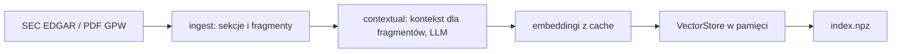
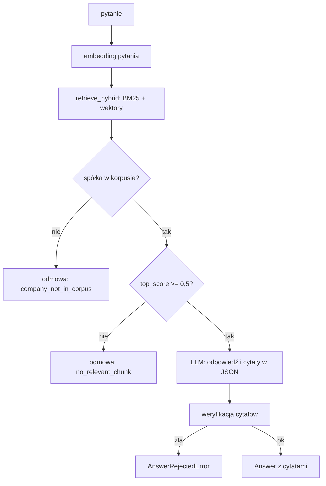

# P2 Zapytaj raport (`filings_rag`)

> Stan na 2026-10-23, commit `d0c43b4`. Opis sprawdzony w kodzie `src/fin_ai_lab/filings_rag/`. Specyfikacja: [docs/specs/p2-filings-rag/](../specs/p2-filings-rag/).

## Odpowiedzialność

P2 odpowiada na pytania o raporty roczne i półroczne spółek. Odpowiedź ma **cytaty**, które są dosłownymi fragmentami dokumentu, albo jest **odmową**, gdy dokument nie zawiera odpowiedzi lub spółki nie ma w korpusie. Cel nauki: RAG od początku do końca (dzielenie na fragmenty, embeddingi, wyszukiwanie hybrydowe, ponowne ocenianie wyników, kontekst dla fragmentów, cytaty i odmowy).

## Korpus: `corpus.py`

| Grupa | Spółki | Źródło | Zakres |
|---|---|---|---|
| USA | Microsoft, Amazon, Oracle, Citigroup, NextEra Energy | raport 10-K z SEC EDGAR (po numerze CIK) | tylko sekcja "Risk Factors" |
| GPW | Atrem, ING Bank Śląski, PKN Orlen | PDF-y sprawozdań zarządu za 1. półrocze 2026 w `data/private/gpw/` (poza gitem) | cały dokument |

Zawężenie do jednej sekcji (`US_SECTION_FILTER = "risk factors"`) jest świadome. Darmowy limit embeddingów (ok. 100 tekstów na minutę) sprawia, że indeksowanie całych raportów trwałoby kilkadziesiąt minut. Zapisany indeks ma ten sam zakres, więc wyniki evali opisują to, co przeszukuje aplikacja webowa.

Model embeddingów: `gemini-embedding-2` (`EMBEDDING_MODEL`).

## Przepływ budowy indeksu



1. **Pobranie i podział (`ingest/`).**
   - `sec_edgar.py`: `SecEdgarClient` (wymaga `SEC_USER_AGENT`, limit 10 żądań/s) pobiera listę zgłoszeń, wybiera najnowszy 10-K (`latest_10k`), pobiera HTML, zamienia na tekst i dzieli na sekcje po nagłówkach "Item N." (`extract_sections`, z obsługą spisu treści).
   - `gpw_pdf.py`: `parse_gpw_report` czyta PDF stronami (`pypdf`). Sekcją jest zakładka PDF, a gdy jej brak, "Strona N". Nazwa sekcji nigdy nie jest zmyślana. Rodzaj dokumentu (roczny, półroczny, kwartalny) podaje wywołujący.
   - `chunking.py`: `chunk_text` dzieli po akapitach na fragmenty do 1200 znaków z zakładką 150 znaków. Dłuższe akapity są cięte na sztywno.
2. **Kontekst (`retrieval/contextual.py`).** `contextualize` prosi LLM o krótki opis kontekstu dla każdego fragmentu (po 10 fragmentów na jedno wywołanie), a opis jest doklejany do tekstu przed embeddingiem. Wyniki są w cache dysku (`data/cache/contextual/`). Do indeksu trafia oryginalny fragment, nie wersja z kontekstem.
3. **Embeddingi (`index/embeddings.py`).** `embed_with_cache` osadza każdy tekst raz, klucz cache to model i skrót tekstu (`data/cache/embeddings/`).
4. **Indeks (`index/builder.py`).** `build_index` buduje spółka po spółce. Spółka, której nie udało się zbudować z przyczyn zewnętrznych (błąd API Gemini, SEC niedostępny, brak PDF na tym komputerze, zepsuta odpowiedź modelu), jest raportowana jako pominięta, a budowa idzie dalej. Błąd w kodzie lub `BudgetExceeded` przerywa całość.
5. **Zapis (`index/persist.py`).** Jeden plik `data/index/filings_rag/index.npz` (poza gitem) z wektorami (float32), fragmentami i metadanymi (model, czas budowy). Zapis do pliku tymczasowego i `os.replace`, więc czytelnik nie zobaczy niedokończonego pliku.

`VectorStore` (`index/store.py`) to wyszukiwanie cosinusowe w pamięci na tablicach NumPy, bez silnika wektorowego (FAISS bywa kłopotliwy bez AVX2, patrz [ENVIRONMENT.md](../ENVIRONMENT.md)).

## Przepływ odpowiedzi



- **`retrieval/hybrid.py`**: `retrieve_hybrid` łączy wynik BM25 (waga 0,65) i podobieństwo wektorowe (waga 0,35), po normalizacji min-max do przedziału 0–1. Przewaga BM25 jest decyzją właściciela: dokładne trafienie słowa, liczby lub nazwy spółki liczy się w danych finansowych bardziej niż zbliżony temat. Filtry: `company`, `fiscal_period`. Domyślnie zwraca 5 fragmentów. Pole `company_in_corpus` jest prawdziwe, gdy zapytanie zawiera nazwę którejś znanej spółki (lub gdy lista znanych spółek nie została podana).
- **`retrieval/naive.py`**: pierwsza, prosta wersja (tylko wektory) i stała `DEFAULT_REFUSAL_THRESHOLD = 0.5`, próg odmowy skalibrowany na zbiorze testowym.
- **`retrieval/rerank.py`**: `rerank` prosi LLM o ocenę trafności każdego kandydata i przestawia kolejność. Wyniki są w cache (`data/cache/rerank/`), a gdy ocena się nie uda, zwraca kandydatów bez zmian. Używany tylko w pipeline'ie evali, bo podwaja liczbę wywołań na pytanie.
- **`answer/builder.py`**: `build_answer` odmawia, gdy spółki nie ma w korpusie albo `top_score` jest poniżej progu. W przeciwnym razie wysyła modelowi pytanie i fragmenty (prompt `answer.v1.md`, odpowiedź w JSON: tekst i lista cytatów). Odmowy mają stałe teksty po polsku.
- **`answer/verify.py`**: `verify_citations_faithful` sprawdza, że **każdy cytat jest dosłownym fragmentem** (po normalizacji białych znaków i wielkości liter) któregoś z odzyskanych fragmentów o zgodnych metadanych (spółka, rodzaj dokumentu, okres, sekcja). Cytat sparafrazowany lub zmyślony to `AnswerRejectedError`.

## Publiczna powierzchnia: `service.py`

To jedyny plik P2, z którego korzystają inne projekty (aplikacja webowa, karta "Zapytaj raport"). Nie buduje ani nie rozszerza indeksu, tylko czyta zapisany.

| Element | Rola |
|---|---|
| `SavedIndexCache` | wczytuje indeks raz i ponownie dopiero po zmianie pliku (po zmianie czasu modyfikacji). Przebudowa z CLI jest widoczna w działającej aplikacji bez restartu |
| `indexed_companies(index)` | lista spółek w indeksie: rodzaj dokumentu, okres, język, sekcje, liczba fragmentów |
| `ask(pytanie, index, company=..., ...)` | jedno wywołanie embeddingu i jedno wywołanie generowania (bez rerankera). Z `company` szuka tylko wśród fragmentów tej spółki i pytanie nie musi jej nazywać. Nieznana spółka to `UnknownCompanyError` |

## Dane XBRL (liczby ze sprawozdań)

`xbrl/client.py` (`XbrlClient`) czyta raportowane liczby wprost z danych XBRL SEC (`companyfacts`), **bez LLM**, więc liczba z XBRL nigdy nie pochodzi od modelu. Pojęcia (`revenue`, `net_income`, ...) są mapowane na etykiety us-gaap w `xbrl/tag_aliases.py` (ręcznie utrzymywane, każdą etykietę sprawdzono na prawdziwych danych korpusu). Gdy ten sam okres raportowano w kilku zgłoszeniach, wygrywa najnowsze.

> **Stan wdrożenia.** `XbrlClient` ma własne testy, ale **żadna ścieżka odpowiedzi go nie wywołuje** (ani `ask`, ani cele evali). Kierowanie pytań liczbowych do XBRL, opisane w README i ROADMAP (P2-S5), nie jest podłączone do pipeline'u odpowiedzi.

## Cele evali: `qa_target.py`

| Cel | Suita | Co robi |
|---|---|---|
| `retrieval_target` | `p2-retrieval-accuracy` | hybryda (pula 15) i rerank, zwraca spółki i sekcje znalezionych fragmentów |
| `answer_target` | `p2-answer-accuracy` | to samo plus `build_answer`: odmowa, powód, liczba cytatów |
| `web_answer_target` | `p2-web-answer-accuracy` | ścieżka aplikacji webowej: zapisany indeks, bez rerankera. Porównanie z `p2-answer-accuracy` pokazuje, ile kosztuje rezygnacja z rerankera. Po przebudowie indeksu uruchamiaj z `--no-cache` |

Indeks do evali jest budowany raz na proces tym samym `build_index`, ale **ostrzej** niż komenda CLI: jeśli któraś spółka się nie zbuduje, eval się zatrzymuje (`EvalIndexIncompleteError`), zamiast działać na niepełnym indeksie, gdzie brak spółki wyglądałby jak błąd modelu. Brak plików GPW na komputerze nie jest błędem (spółka jest po cichu pomijana).

## Prompty

`prompts/answer.v1.md`, `rerank.v1.md`, `contextual.v1.md`. Wersje są przypięte w `suite.yaml` poszczególnych suit.

## Uruchamianie

```bash
uv run fin-ai-lab filings-rag build-index
uv run fin-ai-lab eval p2-retrieval-accuracy
```

Szczegóły w [OPERATIONS.md](../OPERATIONS.md). Wymaga extra `rag` (`bm25s`, `pypdf`) oraz `GEMINI_API_KEY` i `SEC_USER_AGENT`. Przy darmowym limicie Gemini (ok. 20 wywołań generowania dziennie) budowa indeksu korzysta z cache i można ją powtarzać dzień po dniu.

## Testy

`tests/filings_rag/` (`ingest`, `index`, `retrieval`, `answer`, `xbrl`, plus `test_service.py`, `test_qa_target.py`), na atrapach LLM i embeddingów.

## Znane ograniczenia

- Korpus to 8 dokumentów, z czego 5 amerykańskich ogranicza się do "Risk Factors". Pytania o inne sekcje 10-K kończą się odmową.
- Jedna wersja dokumentu na spółkę (najnowszy 10-K, jeden raport półroczny).
- Kierowanie pytań liczbowych do XBRL nie jest podłączone (patrz wyżej).
- Próg odmowy 0,5 pochodzi z `retrieval/naive.py` (skalibrowany na wyniku cosinusowym), a `build_answer` porównuje z nim też wynik hybrydowy, który ma inną skalę (normalizacja min-max i wagi). Zmieniając wagi, sprawdź evalem, czy odmowy nadal działają.
