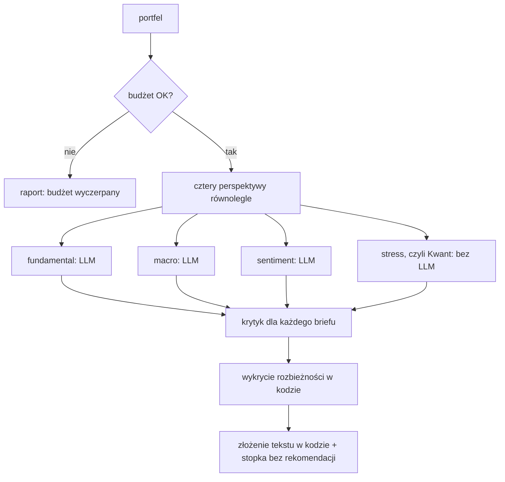

# P5 Komitet inwestycyjny (`investment_committee`)

> Stan na 2026-10-23, commit `d0c43b4`. Opis sprawdzony w kodzie `src/fin_ai_lab/investment_committee/`. Specyfikacja: [docs/specs/p5-investment-committee/](../specs/p5-investment-committee/).

## Odpowiedzialność

P5 analizuje portfel kilkoma "perspektywami" jednocześnie i składa z nich jeden opis. Cel nauki: orkiestracja wielu agentów, rola krytyka (evaluator-optimizer), pamięć między przebiegami, budżety i zgoda człowieka, porównanie A/B z pojedynczym agentem.

Zasady:

- Raport jest **opisowy**: nie mówi "kup" ani "sprzedaj" (stała stopka w kodzie, [ADR-0006](../adr/0006-descriptive-reports-no-investment-advice.md)).
- Liczby liczy kod. Supervisor nie przelicza niczego, co policzył subagent.
- Każde twierdzenie ma mieć identyfikowalne źródło, a krytyk usuwa te bez źródła.

P5 korzysta z P1 bezpośrednio (typy portfela, wagi, kursy walut) oraz z P3 przez `market_pulse.service`.

## Model danych: `models.py`

| Typ | Znaczenie |
|---|---|
| `Perspective` | `fundamental`, `macro`, `sentiment`, `stress` |
| `Claim` | twierdzenie: tekst, `source_type` (`tool_result`, `filing_excerpt`, `computed_metric`), `source_ref` |
| `Brief` | wynik jednej perspektywy: wniosek, `confidence` 0–1, lista twierdzeń |
| `StressScenario` | scenariusz: nazwa, szok per kubełek, wpływ na portfel |
| `Thesis` | teza do rozliczenia po czasie: treść, data, horyzont, perspektywa, pewność, wynik |
| `CommitteeReport` | raport: briefy, rozbieżności, rozliczenia, tekst, koszt |
| `ComparisonReport` | wynik A/B: dwa warianty i zwycięzca jakości |

## Dwa warianty analizy

### Pojedynczy agent: `single_agent.py` (punkt odniesienia)

Jeden agent dostaje cztery narzędzia i sam wybiera, które wywołać (automatyczne wywoływanie funkcji, ten sam wzorzec co agent z P3). Prompt: `single_agent.v1.md`. Zwraca `CommitteeReport` z jednym tekstem.

### Komitet: `supervisor.run_committee`



1. **Subagenci (`subagents/`)** to stałe potoki "jedno narzędzie, jedno wywołanie LLM" ze schematem `Brief`.
   - `fundamental.py`: pyta narzędzie o sprawozdania ze **stałym pytaniem** ("Czy sprawozdania ... wskazują na istotne ryzyka?").
   - `macro.py`: narzędzie reżimu rynku (P3).
   - `sentiment.py`: narzędzie nastroju newsów.
   - `stress.py` ("Kwant"): **zero wywołań LLM**. Scenariusz `Akcje -20%, stopy +200pb, PLN -15%` jest liczony z wag portfela: szok akcji dotyczy też ETF i funduszy (bez analizy składu), obligacje dostają -8% (założone przybliżenie, nie prawdziwe dane o duracji), złotówka -15% na pozycjach w PLN. Pewność wniosku wynosi 1,0, bo dotyczy poprawności arytmetyki, nie prawdopodobieństwa scenariusza.
2. **Krytyk (`critic.py`)**: dla każdego briefu z niezerową pewnością jedno wywołanie LLM zwraca tylko werdykt "ma identyfikowalne źródło / nie ma" dla każdego twierdzenia. **Przepisywanie robi kod**: nieuźródłowione twierdzenia są usuwane, a gdy nie zostaje żadne (lub brief nie miał twierdzeń), brief jest odrzucany (`[ODRZUCONE PRZEZ KRYTYKA]`, pewność 0). Brief z pewnością 0 (np. atrapa narzędzia) jest pomijany. Brak budżetu na krytyka to odrzucenie briefu, nigdy przepuszczenie bez weryfikacji. Zła liczba werdyktów to `ValueError`.
3. **Rozbieżności**: deterministyczny leksykon polskich słów ("wzrost", "poprawa" kontra "spadek", "ryzyk"). Porównywane są tylko briefy z pewnością powyżej 0, a para o przeciwnych nastawieniach trafia na listę rozbieżności. To świadomie proste przybliżenie, nie ocena modelu.
4. **Złożenie tekstu**: sekcje `[perspektywa] wniosek (pewność: ...)`, lista rozbieżności i stopka "nie stanowi rekomendacji".

> **Stan wdrożenia narzędzi.** W `tools.py` narzędzia portfela (`get_portfolio_allocation`) i rynku (`get_market_regime`) są prawdziwe i nie używają LLM. Narzędzia **P2** (`ask_about_filings`) i **P4** (`get_news_sentiment`) są **jawnymi atrapami** i zwracają komunikat, że nie są podłączone. Dlatego perspektywy fundamentalna i nastrojów w raporcie komitetu są dziś w praktyce puste (zero twierdzeń, niska pewność). Specyfikacja dopuszcza taką atrapę, byle nie była ukryta.

## Budżet i zgoda człowieka: `budget.py`

`BudgetGuard(budget_usd, max_iterations, on_budget_exceeded=None)` ma dwa niezależne twarde limity sprawdzane przy każdym wywołaniu: koszt i liczba iteracji. `check(szacowany_koszt)` zwraca `True`, gdy mieści się w obu. Po przekroczeniu:

- bez haka `on_budget_exceeded` odmawia po cichu,
- z hakiem pyta o zgodę **raz na przebieg**, a po akceptacji dalsze sprawdzenia nie pytają ponownie. W CLI hakiem jest `typer.confirm` (flaga `--yes` akceptuje automatycznie).

`record(koszt)` dolicza wydatek i iterację. Przy darmowym kluczu koszt jest zawsze 0, więc w praktyce działa limit iteracji.

## Pamięć tez: `memory/`

- `theses.py`: `append_theses` i `load_theses` (plik JSONL na portfel, tylko dopisywanie, `data/memory/investment_committee/<portfel>.jsonl`, poza gitem). `reckon_theses` to czysta funkcja: oznacza `not_yet_resolvable` tezy, których horyzont jeszcze nie minął, a nie ocenia, czy minione tezy się sprawdziły (zostawia `outcome = None`). Horyzont jest parsowany z tekstu (dni, tygodnie, miesiące, lata, po angielsku i polsku); nierozpoznany horyzont jest traktowany jak "nie wiadomo kiedy".
- `calibration.py`: `brier_score` i `brier_score_by_perspective` liczą kalibrację pewności z już rozliczonych tez (pomijają nierozstrzygnięte).

> **Stan wdrożenia.** Pamięć jest kompletna jako moduł z testami, ale **żaden etap potoku (pojedynczy agent ani komitet) nie zapisuje tez ani ich nie rozlicza**. To osobna decyzja, której nie opisuje projekt techniczny.

## Porównanie A/B: `qa_target.compare_committee_vs_single`

Uruchamia oba warianty na tym samym portfelu, **każdy z własnym `BudgetGuard` o takim samym limicie** (żaden nie wyczerpie drugiemu budżetu), mierzy czas (`time.monotonic()`), a potem sędzia LLM ocenia jakość **na ślepo**: widzi "raport a" i "raport b", nigdy który wariant jest którym (prompt `comparison_judge.v1.md`). Wynik: `ComparisonReport` z kosztem, latencją i zwycięzcą (`single_agent`, `committee` albo `tie`) z uzasadnieniem.

## Publiczna powierzchnia: `service.py`

Eksportuje `BudgetGuard`, `CommitteeReport`, `ComparisonReport`, `compare_committee_vs_single`, `run_committee`, `run_single_agent`. Stąd korzysta karta "Analiza AI" w aplikacji webowej.

## Uruchamianie

```bash
uv run fin-ai-lab investment-committee analyze <plik> --valuation-date 2026-10-23 --committee
uv run fin-ai-lab investment-committee compare <plik> --valuation-date 2026-10-23
```

Opcje: `--account-type` (domyślnie `regular`), `--market-currency` (`PLN`), `--broker` (tylko dla nieznanego formatu), `--model` (`gemini-3.6-flash`), `--budget-usd` (`1.00`), `--max-iterations` (`10`), `--yes`, `--committee` (bez niego działa pojedynczy agent). Wymaga `GEMINI_API_KEY` i `FRED_API_KEY`. Szczegóły w [OPERATIONS.md](../OPERATIONS.md).

## Testy

`tests/investment_committee/` (`memory`, `subagents`, `test_budget.py`, `test_critic.py`, `test_qa_target.py`, `test_single_agent.py`, `test_supervisor.py`, `test_tools.py`), na atrapach LLM. Nie ma na razie evali tego projektu w `evals/`, a żywe porównanie A/B (metryka sukcesu: komitet wygrywa w co najmniej 60% portfeli) czeka na zbiór portfeli testowych i dzienny limit Gemini.

## Znane ograniczenia

- Narzędzia P2 i P4 są atrapami (patrz wyżej), więc dwie z czterech perspektyw nie mają dziś danych.
- Pamięć tez nie jest podłączona do potoku.
- Model stresu jest ilustracyjny, bez prawdziwego modelu ryzyka (brak duracji, brak kursów krzyżowych).
- Wykrywanie rozbieżności opiera się na małym leksykonie słów.
- Pełny żywy przebieg komitetu bywa blokowany dziennym limitem Gemini (ok. 20 wywołań na dobę).
