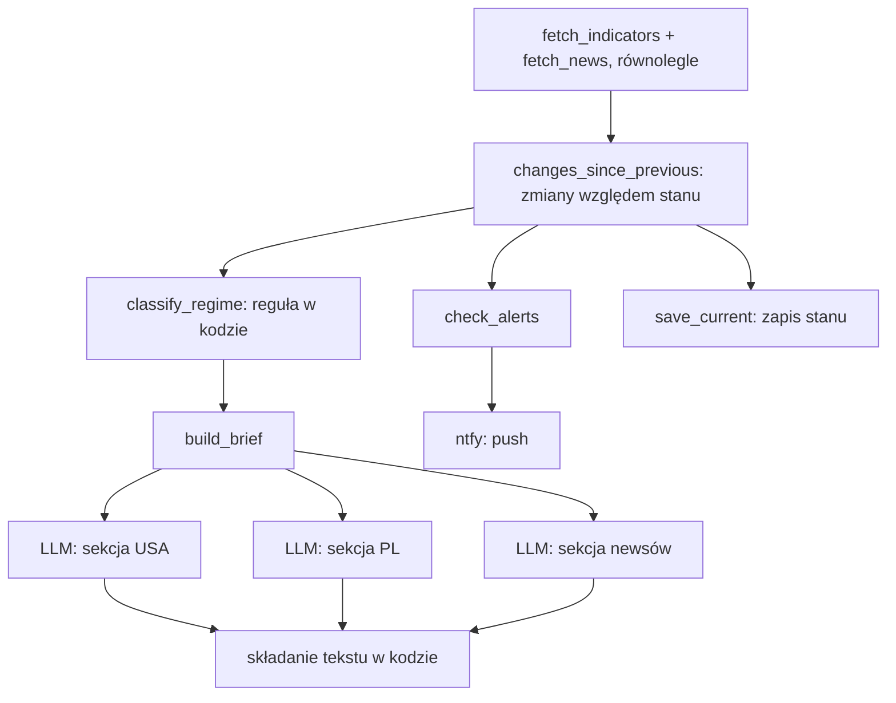

# P3 Market Pulse (`market_pulse`)

> Stan na 2026-10-23, commit `d0c43b4`. Opis sprawdzony w kodzie `src/fin_ai_lab/market_pulse/`. Specyfikacja: [docs/specs/p3-market-pulse/](../specs/p3-market-pulse/).

## Odpowiedzialność

P3 buduje codzienny **brief rynkowy** z kilku wskaźników makro (USA i Polska) i nagłówków prasowych, ocenia **reżim rynku regułą w kodzie**, wysyła **alerty** o dużych zmianach i pozwala zadać pytanie agentowi, który sam wybiera źródło danych. Cel nauki: używanie narzędzi przez model, własny serwer MCP, wzorzec "orkiestrator i pracownicy", stan między przebiegami i harmonogram.

Zasada: etykietę reżimu i zmiany wskaźników liczy kod. Model tylko opisuje już policzone dane.

## Układ

```
market_pulse/
├── service.py          publiczna powierzchnia (dla aplikacji webowej i P5)
├── models.py           IndicatorObservation, RegimeResult, Brief, NewsItem, Alert
├── sources/            fred.py, nbp.py, news.py, yfinance_client.py
├── indicators.py       równoległe pobranie wszystkich wskaźników
├── regime.py           reguła reżimu rynku
├── state.py            stan poprzedniego przebiegu i zmiany dzień do dnia
├── alerts.py           progi alertów
├── notifications/ntfy.py   powiadomienia push
├── brief.py            skład briefu (3 wywołania LLM równolegle)
├── tools.py            narzędzia dla agenta
├── agent.py            pytania do agenta
├── mcp_server.py       serwer MCP
├── regime_cases.py     budowa przypadków do backtestu
├── qa_target.py        cele evali
└── prompts/            ask, brief_us, brief_pl, brief_news (wszystkie v1)
```

## Dane

| Źródło | Co | Klucz | Uwagi |
|---|---|---|---|
| FRED (`sources/fred.py`) | `DGS10`, `DGS2`, `T10Y2Y`, `DFF`, `CPIAUCSL`, `UNRATE`, `VIXCLS` | `FRED_API_KEY` | ostatnia obserwacja do wskazanej daty; wartość `.` (brak publikacji) to brak danych. Zapytanie ma `observation_end`, więc cache dysku jest poprawny także następnego dnia |
| NBP kursy (`sources/nbp.py`) | `EUR/PLN`, `USD/PLN` (tabela A) | brak | cofa się dzień po dniu do 10 dni przez weekendy i święta |
| NBP stopa referencyjna | `stopa_referencyjna` | brak | czytana z `static.nbp.pl/dane/stopy/stopy_procentowe.xml`, **z pominięciem cache**, bo plik zawsze odzwierciedla stan bieżący |
| RSS (`sources/news.py`) | Bankier, Strefa Inwestorów, po 5 pozycji | brak | także z pominięciem cache. Tytuł ucięty do 120, streszczenie do 150 znaków (ograniczenie prawa cytatu, patrz [DATA-SOURCES.md](../DATA-SOURCES.md)) |
| Yahoo (`sources/yfinance_client.py`) | WIG20 | brak | **tylko serwer MCP**, nigdy brief ani agent (brak darmowego, zautomatyzowanego źródła WIG20) |

Wspólny typ: `IndicatorObservation` (`series_id`, `label`, `value`, `unit`, `as_of_date`, `source`, plus `previous_value` i `change` uzupełniane z poprzedniego przebiegu). Wartości to `Decimal`.

`fetch_indicators` pobiera wszystkie wskaźniki równolegle. Źródło, które zawiodło lub niczego nie opublikowało, jest pomijane i wpisane na listę `missing_sources` (np. `fred:VIXCLS`), zamiast przerywać przebieg.

## Przebieg briefu



1. **Reżim (`regime.py`)**: `classify_regime` zwraca `risk-off`, gdy krzywa rentowności jest odwrócona (`T10Y2Y <= 0`) lub `VIXCLS >= 25`. Inaczej `neutral`. Typ ma też wartość `risk-on`, ale żadna reguła jej jeszcze nie ustawia. Progi są oznaczone jako założenie startowe, weryfikowane backtestem.
2. **Zmiany (`state.py`)**: `changes_since_previous` dopisuje `previous_value` i `change` na podstawie `data/state/market_pulse.json` (poza gitem; brak pliku to po prostu pierwszy przebieg). Plik można bezpiecznie usunąć.
3. **Brief (`brief.py`)**: wzorzec orkiestrator-pracownicy. Trzy niezależne wywołania LLM (USA, PL, newsy) idą równolegle, a tekst składa kod. Linia o reżimie jest w całości budowana w kodzie z `RegimeResult`, bez udziału modelu. Pusta sekcja dostaje stały tekst ("Brak danych ..."), a niedostępne źródła są wymienione na końcu.
4. **Alerty (`alerts.py`)**: `check_alerts` porównuje `|change|` z progiem per wskaźnik (np. 0,10 p.p. dla rentowności, 3,0 dla VIX, 0,02 dla kursów, 0,05 dla stopy NBP). Brak progu albo brak zmiany (pierwszy przebieg) to brak alertu, a cisza jest wynikiem poprawnym.
5. **Powiadomienia (`notifications/ntfy.py`)**: jeden push na alert przez `ntfy.sh` (zwykły POST, temat pełni rolę sekretu), wymaga `NTFY_TOPIC`.

## Agent i MCP

- `tools.py` buduje trzy narzędzia (`get_fred_series_value`, `get_nbp_fx_rate`, `get_nbp_reference_rate`). Opisy i typy w docstringach są tym, co SDK pokazuje modelowi, więc pisane są z myślą o modelu.
- `agent.ask` wysyła pytanie z narzędziami; model sam wybiera, które wywołać (automatyczne wywoływanie funkcji w SDK). Wynik to `AgentAnswer(text, tool_calls)`. Lista wywołanych narzędzi służy do oceny trajektorii.
- `mcp_server.build_server` wystawia te same narzędzia plus `get_wig20_price` jako serwer MCP (do użytku z Claude Desktop/Code). Uruchomienie: `uv run python -m fin_ai_lab.market_pulse.mcp_server` (wymaga `FRED_API_KEY`).

## Publiczna powierzchnia: `service.py`

Eksportuje: `ask`, `fetch_indicators`, `classify_regime`, `load_previous`, `FredClient`, `NbpClient`, `IndicatorObservation`, `Regime`, `STATE_PATH`. Stąd korzystają karta "Puls rynku" w aplikacji i P5, nigdy z modułów wewnętrznych.

## Evale

| Suita | Cel | Co sprawdza |
|---|---|---|
| `p3-regime-backtest` | `regime_backtest_target` | reguła reżimu na historycznych datach. Bez LLM, na wartościach podanych w przypadku (deterministycznie). Przypadki budowane skryptem `scripts/market_pulse_build_regime_cases.py` z danych FRED (wymaga `FRED_API_KEY`), a w repo są tylko `scenarios.jsonl` bez wartości (licencja) |
| `p3-trajectory` | `trajectory_target` | czy agent wywołał właściwe narzędzia (grader `set_f1`), czy tylko napisał wiarygodny tekst |

`regime_cases.py` zamienia scenariusze (data, serie, oczekiwany reżim) w przypadki z uzupełnionymi wartościami.

## Harmonogram

Skrypty w `scripts/`:

- `market_pulse_register_task.ps1`: jednorazowo rejestruje w Harmonogramie zadań Windows zadanie `fin-ai-lab-market-pulse-brief` uruchamiane codziennie o 7:00 (`-StartWhenAvailable` nadrabia przebieg, gdy komputer był wyłączony). Zmienia stan systemu, więc uruchamiasz je ręcznie, nie automatycznie.
- `market_pulse_run_brief.ps1`: uruchamia `uv run fin-ai-lab market-pulse brief --output data\briefs\<data>.md` i zapisuje log obok.

## Uruchamianie

```bash
uv run fin-ai-lab market-pulse brief --output brief.md
uv run fin-ai-lab market-pulse ask "Jaka jest teraz rentowność 10-latek w USA?"
```

Wymaga extra `pulse` (`mcp`, `yfinance`) oraz `GEMINI_API_KEY` i `FRED_API_KEY`; `NTFY_TOPIC` tylko, gdy ma się pojawić alert. Szczegóły w [OPERATIONS.md](../OPERATIONS.md).

## Testy

`tests/market_pulse/` (`sources`, `test_agent.py`, `test_alerts.py`, `test_brief.py`, `test_indicators.py`, `test_mcp_server.py`, `test_ntfy.py`, `test_regime.py`, `test_regime_cases.py`, `test_state.py`, `test_tools.py`; `test_agent_live.py` jest pomijany bez klucza).

## Znane ograniczenia

- Reguła reżimu zna tylko dwa sygnały ucieczki od ryzyka. Wartość `risk-on` nie jest nigdy zwracana.
- Progi reżimu i alertów to wartości startowe, nieskalibrowane na długiej historii.
- WIG20 jest dostępny tylko interaktywnie (Yahoo bywa blokowany).
- Przy wielu wywołaniach narzędzi w jednym zapytaniu koszt w śladzie jest zaniżony (patrz [core.md](core.md)).
