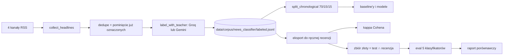

# P4 Klasyfikator polskich newsów (`news_classifier`)

> Stan na 2026-10-23, commit `d0c43b4`. Opis sprawdzony w kodzie `src/fin_ai_lab/news_classifier/`, w `scripts/` i w `evals/p4-*`. Specyfikacja: [docs/specs/p4-news-classifier/](../specs/p4-news-classifier/). Raport porównawczy: [p4-s7-comparison.md](../specs/p4-news-classifier/reports/p4-s7-comparison.md).

## Odpowiedzialność

P4 klasyfikuje polskie nagłówki giełdowe pod względem **nastroju** (`negative`, `neutral`, `positive`), **typu zdarzenia** (13 wartości) i **spółek** z katalogu. Jest to projekt o uczeniu modeli: etykiety zbiera model-nauczyciel, a pięć klasyfikatorów porównuje się na tym samym ręcznie oznaczonym zbiorze testowym.

## Model danych: `models.py`

- `Headline`: nagłówek, opcjonalny lead (maks. 150 znaków, treść artykułu nigdy nie jest zapisywana), źródło, data publikacji, język `pl`.
- `Label`: `sentiment`, `event_type`, `tickers`.
- `EventType`: `wyniki finansowe`, `dywidenda`, `emisja akcji`, `skup akcji`, `przejęcie lub fuzja`, `zmiana w zarządzie`, `prognoza`, `decyzja lub kara regulatora`, `spór prawny`, `umowa lub kontrakt`, `rekomendacja lub rating`, `makro`, `inne`.
- `LabeledHeadline`: nagłówek, etykieta i `source_model` (kto ją nadał).
- `ticker_catalog.py`: ręcznie utrzymywany katalog tickerów (dziś `ATR` Atrem, `PKN` PKN Orlen, `ING` ING Bank Śląski). Nie istnieje darmowe, automatyczne źródło pełnej listy GPW, a rozszerza się go ręcznie.

## Przepływ danych



### Zbieranie: `ingest/news_rss.py`

`collect_headlines` pobiera RSS z czterech źródeł (`bankier`, `bankier-wiadomosci`, `strefa-inwestorow`, `comparic`). Kanał, który zawiedzie, jest po cichu pomijany. RSS nie ma głębokiej historii, więc korpus rośnie przez **wielokrotne zbieranie w czasie**, a nie jednorazowe pobranie.

### Etykietowanie nauczycielem: `labeling/`

- `teacher.py`: `label_with_teacher` robi **jedno wywołanie na nagłówek** (bez Batch API, bo wymaga billingu), prompt `teacher.v2.md`, odpowiedź zgodna ze schematem `Label`. Błąd jednego nagłówka (zły schemat albo chwilowa awaria API) jest zapisany na liście błędów, a pętla idzie dalej, żeby nie stracić już zdobytych etykiet. Parametr `max_calls` ogranicza liczbę wywołań w przebiegu.
- Prompt ma dwie wersje, bo v1 mówił o "zamkniętej liście ze schematu", co działa tylko u dostawców przekazujących schemat modelowi (Gemini tak, Groq nie, ok. 30% etykiet miało typ spoza listy). Wersja v2 wypisuje listę w samym tekście.
- `progress.py`: `headline_key` (stabilna tożsamość nagłówka), zapis i odczyt kluczy już oznaczonych, `unlabeled`, `dedupe_pending_by_text` (te same wiadomości z dwóch kanałów nie kosztują dwóch wywołań).
- Domyślnie nauczycielem jest Groq (`openai/gpt-oss-120b`), bo to zadanie zużywa najwięcej wywołań ze wszystkich projektów ([ADR-0007](../adr/0007-groq-secondary-llm-provider.md)).
- Korpus: `corpus_store.py`, plik `data/corpus/news_classifier/labeled.jsonl` (poza gitem).

### Kalibracja: `labeling/review.py`, `calibration.py`

1. `export_for_review` zapisuje losową (ziarno 42, więc powtarzalną) próbę do CSV **bez etykiet nauczyciela**, z pustymi kolumnami `human_*`. Człowiek ocenia na ślepo, żeby nie zakotwiczyć się na odpowiedzi modelu.
2. `score_calibration` liczy zgodność: kappa Cohena osobno dla nastroju i typu zdarzenia oraz dokładną zgodność tickerów. Puste wiersze są pomijane.
3. Poprzeczka to kappa 0,6. Wynik z 2026-09-19 to 0,461 (nastrój) i 0,451 (typ zdarzenia), poniżej poprzeczki. Właściciel świadomie przyjął ten wynik (odstępstwo od wymagania REQ-011, nie błąd).
4. `build_golden_set` zamienia oceniony CSV w **zbiór złoty**: przecięcie ręcznie ocenionych nagłówków z podziałem testowym.

### Podział: `split.py`

`split_chronological` dzieli 70/15/15 od najstarszych do najnowszych, po usunięciu duplikatów (równość po normalizacji białych znaków i wielkości liter). Ta sama normalizacja służy do deduplikacji w etykietowaniu.

## Pięć klasyfikatorów

Wszystkie dostają ten sam zbiór treningowy (podział treningowy korpusu) i są oceniane na tym samym zbiorze złotym.

| Klasyfikator | Plik | Opis | Suita |
|---|---|---|---|
| Większościowy | `baselines/majority.py` | zawsze najczęstsza klasa z treningu; `tickers` puste | `p4-classifier-majority` |
| TF-IDF + regresja logistyczna | `baselines/tfidf_logreg.py` | dwa klasyfikatory (nastrój, typ zdarzenia); tickery z deterministycznego dopasowania nazwy spółki z katalogu | `p4-classifier-tfidf` |
| Few-shot LLM | `baselines/few_shot_llm.py` | 5 pierwszych przykładów z treningu w prompcie (`few_shot.v1.md`), schemat `Label`; domyślnie `openai/gpt-oss-120b` | `p4-classifier-few-shot` |
| HerBERT | `qa_target_herbert.py` | `allegro/herbert-base-cased` dostrojony w Colab, osobny model dla nastroju i typu zdarzenia; checkpointy lokalnie w `data/private/herbert_checkpoints/` | `p4-classifier-herbert` |
| Bielik skwantyzowany | `qa_target_quantized.py`, `inference/quantized.py` | `speakleash/Bielik-1.5B-v3.0-Instruct` + LoRA, GGUF Q4_K_M, lokalnie na CPU przez llama.cpp; `data/private/bielik_quantized/model.gguf` | `p4-classifier-quantized` |

Moduły HerBERT i Bielika są oddzielone od `qa_target.py`, żeby trzy pierwsze suity działały bez ciężkich extras (`herbert`, `quantized`).

Wszystkie suity używają graderów `classification_metrics` na polach `sentiment` i `event_type`. Metryki (`metrics.py`): `per_class_metrics`, `macro_f1` (średnia po klasach, które występują w zbiorze), `confusion_matrix`. Zwykła trafność wprowadzałaby w błąd przy niezbalansowanych klasach.

### Raport porównawczy: `comparison_report.py`

`fin-ai-lab news-classifier compare-report` czyta **najnowszy przebieg** każdej z pięciu suit (`SUITES`: `majority`, `tfidf`, `few-shot`, `herbert`, `quantized`) i zapisuje jeden raport (domyślnie `docs/specs/p4-news-classifier/reports/p4-s7-comparison.md`): macro-F1, macierze pomyłek, czas i koszt na 1000 nagłówków.

## Wyniki (stan z raportu S7)

W czasie raportu S7 korpus miał 92 nagłówki (do 2026-10-21 urósł do 1347, bo rośnie codziennie), a zbiór złoty, czyli ręcznie ocenione nagłówki z części testowej, ma 13 przypadków. Na tamtym korpusie: klasa większościowa, TF-IDF i HerBERT zapadają się do najczęstszej klasy (macro-F1 nastroju 0,21). Wygrywa few-shot LLM (0,56 nastrój, 0,49 typ zdarzenia) kosztem czasu i wywołań API. Szczegóły i wnioski: [LEARNING.md](../LEARNING.md) i raport.

## Bielik: trening, kwantyzacja, inferencja

- **Trening**: notatniki Colab w `training/` (`herbert_finetune.ipynb`, `bielik_lora_finetune.ipynb`), nie część pakietu. Checkpointy zostają na Dysku Google właściciela. Notatnik Bielika klonuje gałąź `main`, więc zmiany działają w Colab dopiero po merge'u. Instrukcja: `training/README.md`.
- **Prompt treningowy i inferencyjny**: `prompts/bielik_sft.v1.md` (wspólny dla treningu, ewaluacji i `classify_quantized`; spisuje kształt JSON w treści, bo dekoder generatywny nie ma `response_schema`).
- **Kwantyzacja**: `scripts/news_classifier_quantize_bielik.py` scala adapter z modelem bazowym, konwertuje do GGUF (f16), kwantyzuje do Q4_K_M. Wymaga osobnego środowiska konwersji z klonem llama.cpp w `tools/` (poza gitem) i łatki `scripts/patches/llama_cpp_hf_vocab_score.patch`. Na końcu sprawdza, czy llama.cpp tokenizuje prompt tak samo jak `transformers`, i przerywa przy różnicy.
- **Rozpoznawanie przestarzałych wyników**: `inference/build_record.py` zapisuje odcisk adaptera (SHA-256 wszystkich plików) obok każdego wyniku, więc skrypt sam przebudowuje te, które powstały z innego adaptera.
- **Zgodność tokenizerów**: `inference/conversion_tokenizer.py` dopisuje tokeny specjalne pod nazwą rozumianą przez starszy `transformers` w środowisku konwersji, a `first_mismatch` wskazuje pierwszą różnicę dwóch tokenizacji.
- **Inferencja**: `classify_quantized` używa `llama-cpp-python`, kontekstu 2048 tokenów, temperatury 0 i **gramatyki JSON** wymuszającej poprawny kształt `Label` (nie naprawia złej etykiety, tylko zepsuty format). `ChatCompletionClient` to wstrzykiwany interfejs, więc testy nie potrzebują pliku GGUF. Niepoprawna odpowiedź to `ValueError`.
- **Historia usterek** (dokładne opisy w `inference/README.md`): niedokończony stub w llama.cpp (puste odpowiedzi, naprawiony łatką), ucięcie przykładów treningowych przez `max_length=512` ([issue #1](https://github.com/devTomaszStoklosa/fin-ai-lab/issues/1), notatnik poprawiony na 1024), rozbieżna tokenizacja i podwójny token początku tekstu ([issue #7](https://github.com/devTomaszStoklosa/fin-ai-lab/issues/7), naprawione). Model czeka na ponowny trening, więc macro-F1 `p4-classifier-quantized` wynosi na razie 0.

## Skrypty i harmonogram

| Skrypt | Rola |
|---|---|
| `news_classifier_register_task.ps1` | jednorazowo rejestruje zadanie `fin-ai-lab-news-classifier-label` codziennie o 6:30 |
| `news_classifier_run_labeling.ps1` | uruchamia `news-classifier label --max-calls 300`, log w `data/news_classifier_runs/` |
| `news_classifier_build_eval_cases.py` | buduje zbiór złoty i zapisuje identyczne `cases.jsonl` w pięciu suitach (pliki poza gitem, to prawdziwe nagłówki prasowe) |
| `news_classifier_quantize_bielik.py` | kwantyzacja, patrz wyżej |

## Publiczna powierzchnia: `service.py`

Eksportuje `CORPUS_PATH` i `load_labeled`. Stąd korzysta karta "Porównanie modeli" w aplikacji webowej.

## Uruchamianie

```bash
uv run fin-ai-lab news-classifier label --max-calls 15
uv run fin-ai-lab news-classifier export-review
uv run fin-ai-lab news-classifier score-review
uv run fin-ai-lab eval p4-classifier-few-shot --split test
uv run fin-ai-lab news-classifier compare-report
```

Szczegóły i opcje w [OPERATIONS.md](../OPERATIONS.md). Wymaga extra `ml` (`numpy`, `scikit-learn`), do HerBERT dodatkowo `herbert` (`torch`, `transformers`), do Bielika `quantized`, oraz `GROQ_API_KEY` (etykietowanie) lub `GEMINI_API_KEY`.

## Testy

`tests/news_classifier/` (`baselines`, `inference`, `ingest`, `labeling`, `test_comparison_report.py`, `test_metrics.py`, `test_split.py`).

## Znane ograniczenia

- Zbiór złoty ma tylko 13 przypadków (ogranicza go liczba ręcznie ocenionych nagłówków z części testowej), a wyniki z raportu S7 pochodzą z korpusu o 92 nagłówkach. Wyniki służą do porównania wariantów, nie jako benchmark.
- Zgodność nauczyciela z człowiekiem jest poniżej przyjętej poprzeczki (kappa ok. 0,45).
- Modele dostrojone zapadają się do klasy większościowej na tak małym korpusie.
- Katalog tickerów zawiera trzy spółki.
- Z powodu licencji (treści prasowe) pliki `cases.jsonl` suit P4 nie są w repo, odtwarza się je skryptem ([EVALS.md](../EVALS.md)).
