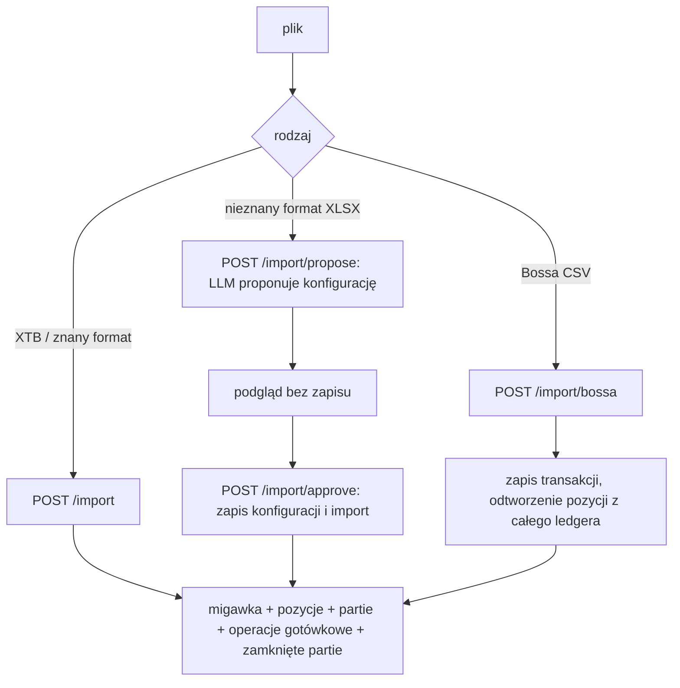
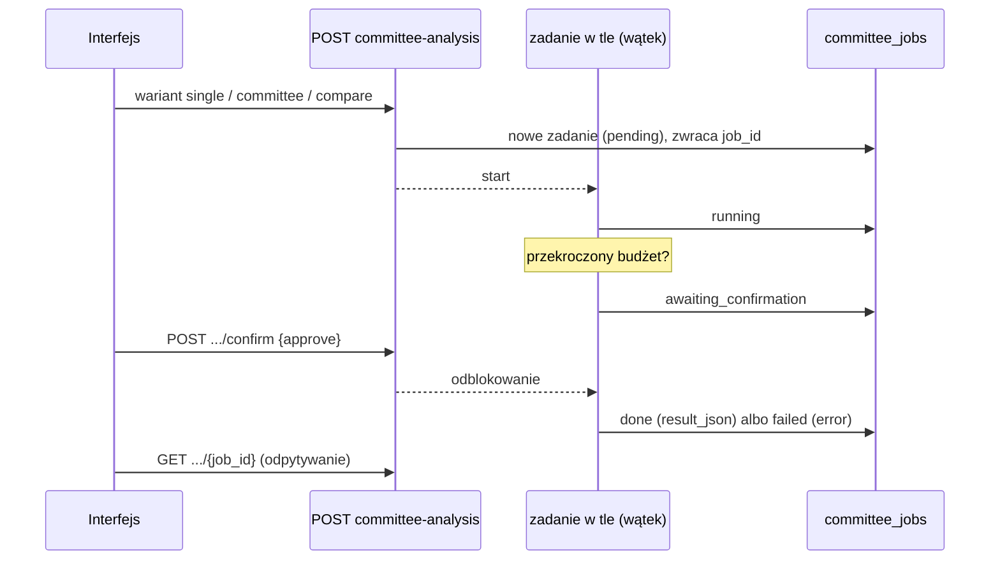

# Aplikacja webowa: backend (`portfolio_webapp`)

> Stan na 2026-10-23, commit `d0c43b4`. Opis sprawdzony w kodzie `src/fin_ai_lab/portfolio_webapp/` (ok. 10 400 linii). Specyfikacja: [docs/specs/portfolio-webapp/](../specs/portfolio-webapp/). Interfejs użytkownika: [frontend.md](frontend.md).

## Odpowiedzialność

Aplikacja jest webową warstwą nad P1–P5. Pozwala trzymać wiele portfeli (z różnych brokerów), importować eksporty, oglądać wartość dzień po dniu, wynik inwestycyjny, dywidendy i ich podatek, porównanie z indeksem, podziały portfela oraz analizę AI. Działa lokalnie, dla jednego właściciela, bez logowania: serwer nasłuchuje wyłącznie na `127.0.0.1`.

Dane portfela są prywatne. Baza leży w `data/private/portfolio_webapp.duckdb` (poza gitem).

## Uruchamianie

```bash
uv run fin-ai-lab web            # backend, domyślnie port 8010 ($PORT albo --port)
npm run dev --prefix frontend    # interfejs (Vite proxy kieruje /api na port 8010)
```

Opcje komendy `web`: `--port` (domyślnie `$PORT`, w przeciwnym razie 8010) i `--db-path` (domyślnie plik wyżej). Wymaga extra `ui` (`fastapi`, `uvicorn`, `duckdb`). `GET /health` zwraca `{"status": "ok"}`. Autostart przy logowaniu: [OPERATIONS.md](../OPERATIONS.md).

## Układ kodu

```
portfolio_webapp/
├── api/                     routery FastAPI (jeden plik na obszar)
│   ├── app.py               create_app(): wstrzykiwanie zależności, start bazy
│   ├── deps.py              AppDeps: komplet zależności dla routerów
│   ├── defaults.py          stałe i domyślne (produkcyjne) zależności
│   ├── common.py            współdzielone funkcje routerów
│   └── live_values.py       bieżące wartości pozycji (cena dnia + kurs)
├── schemas.py               modele wejścia i wyjścia API (pydantic)
├── db.py                    schemat DuckDB i migracje
├── repository.py            cały dostęp do bazy (zapytania SQL)
├── valuation.py             czysta logika wyceny dzień po dniu
├── valuation_builder.py     zbiera dane i buduje odpowiedź wyceny
├── lots.py, lot_history.py, closed_lots.py, xtb_symbols.py   historia zakupów XTB
├── cash_operations.py, bossa_financial.py, investment_result.py   gotówka i wynik
├── dividends*.py, dividend_tax.py, dividend_forecast*.py     dywidendy
├── benchmark.py, benchmark_builder.py                         porównanie z indeksem
├── breakdowns.py, shares_builder.py, aggregators.py           podziały i agregatory
├── instruments*.py, traded_instruments*.py, instrument_overrides*.py   tożsamość instrumentów
├── manual_valuations.py, yahoo_ticker.py
```

### Zasady konstrukcji

1. **Wstrzykiwanie zależności.** `create_app(...)` przyjmuje ponad 20 parametrów: fabryki klientów (OpenFIGI, LLM, kursy NBP, FRED), funkcje pobierające dane (zamknięcia dzienne, dywidendy, kursy waluty notowań), ścieżki plików i "dzisiaj". Produkcja dostaje prawdziwe implementacje, testy atrapy (`FakeLlmClient`, zamknięcia z kanonicznych serii), więc testy nigdy nie dotykają sieci. Zależności są spięte w niezmienny `AppDeps` i każdy router bierze z niego tylko to, co potrzebuje.
2. **Logika czysta oddzielona od zbierania danych.** Pliki bez końcówki `_builder` (`valuation.py`, `dividends.py`, `dividend_forecast.py`, `investment_result.py`, `benchmark.py`, `breakdowns.py`, `instruments.py`...) nie dotykają bazy ani sieci, a każda kwota to `Decimal`. Pliki `*_builder.py` zbierają dane z bazy, Yahoo i NBP i wywołują czystą logikę.
3. **Połączenie z bazą.** `get_db` zwraca `cursor()`, a nie wspólne połączenie: FastAPI uruchamia zwykłe endpointy w puli wątków, a równoległe `execute()` na jednym połączeniu DuckDB psuły sobie wyniki.
4. **Granice modułów.** Aplikacja korzysta z P2–P5 wyłącznie przez ich `service.py`, a z P1 (typy portfela, parsery, wagi, kursy) bezpośrednio. Pilnuje tego `tests/test_architecture.py`.
5. **Start serwera (`lifespan`).** Otwiera bazę (tworzy tabele i uruchamia migracje), wczytuje wszystkie prompty do jednego rejestru (P1, raport, sektory, P3, P5, P2), tworzy pamięć podręczną indeksu P2, blokady raportów per portfel i struktury zadań komitetu.

## Baza danych (DuckDB, 18 tabel): `db.py`

Cały schemat jest tworzony od razu (`CREATE TABLE IF NOT EXISTS`). Kolumny dodane później przechodzą przez idempotentne `MIGRATIONS`. Dodatkowo dwie migracje danych uruchamiane przy każdym starcie: przebudowa klucza głównego `transactions` na `(portfolio_id, dedup_hash)` (#247) i przeniesienie ręcznie nadpisanych wartości pozycji ręcznych do wycen (#288).

| Tabela | Zawartość |
|---|---|
| `portfolios` | portfele: nazwa, broker, typ konta |
| `portfolio_snapshots` | jeden import = jedna migawka: broker, data wyceny, zakres dat pliku |
| `positions` | pozycje migawki (pola jak `Position` z P1, kwoty `DECIMAL(24,8)`) |
| `position_lots` | partie zakupu pozycji (XTB), służą do datowania przed importem |
| `transactions` | transakcje Bossa; klucz `(portfolio_id, dedup_hash)`, więc ten sam plik w dwóch portfelach to dwa zestawy |
| `cash_operations` | operacje gotówkowe (XTB Cash Operations, Bossa historia finansowa): rodzaj, kwota ze znakiem, waluta, ticker i komentarz do powiązania dywidendy |
| `closed_lots` | zamknięte partie XTB (okres trzymania, koszt, przychód) |
| `reports` | zapisane raporty AI, per migawka |
| `aggregators` | agregatory: nazwane grupy instrumentów i innych agregatorów |
| `breakdowns`, `breakdown_groups`, `breakdown_assignments` | podziały: drzewa grup; klucz główny przypisań gwarantuje jedną grupę na instrument w podziale |
| `instrument_decisions` | decyzje właściciela "to ten sam instrument / to różne" dla par kluczy |
| `instrument_listings` | notowanie wybrane do wyceny każdego ISIN z ledgera Bossa (także sprzedanych) |
| `instrument_overrides` | własny symbol Yahoo i waluta notowań wpisane przez właściciela |
| `manual_valuations` | własne wyceny pozycji ręcznej (jedna na dzień) |
| `committee_jobs` | zadania analizy komitetu: wariant, status, wynik w JSON |

Klucz instrumentu to ISIN, a gdy go brak, `broker:symbol` (nigdy `id` wiersza pozycji, bo zmienia się przy każdym imporcie).

## Przepływy

### Import



- **XTB i znane formaty** (`/import`): P1 `import_file`, potem zapis migawki i pozycji. Z tego samego pliku best-effort czytane są partie otwarte, arkusz Cash Operations i Closed Positions (jeśli są). Ich błąd nie przerywa importu, tylko dodaje ostrzeżenie. Operacje gotówkowe i zamknięte partie mają własne klucze (XTB nadaje ID, partie dostają skrót), więc ponowny import zachodzącego eksportu dodaje tylko nowe wiersze.
- **Nieznany format**: `/import/propose` (LLM, pętla naprawy z P1) zwraca podgląd konfiguracji i pozycji **bez zapisu czegokolwiek**. Dopiero `/import/approve` zapisuje konfigurację (nowy plik YAML z wyższą wersją w `parsers/`) i importuje plik.
- **Bossa** (`/import/bossa`): akceptuje ledger transakcji (hisPW) albo historię finansową (rozliczenia transakcji, dywidendy, wpłaty). Transakcje są dopisywane do bazy (deduplikacja po skrócie wiersza), a **pozycje zawsze powstają z odtworzenia całego zapisanego ledgera**, nie tylko z ostatniego pliku, więc wcześniejszy import nie znika. Dla każdego ISIN z ledgera (także sprzedanych) wyznaczane jest notowanie do wyceny (`traded_instruments*`, OpenFIGI i waluta rozliczenia transakcji).
- Błędy walidacji zwracają 422 z `{"errors": [...], "warnings": [...]}`. Podejrzane komórki (wyglądające jak polecenia do modelu) trafiają do `warnings`.

### Wycena dzień po dniu (`valuation.py`, `valuation_builder.py`)

Wartość w dniu *d* to suma po instrumentach `ilość(d) × wartość jednostki(d)`, a oba czynniki liczone są osobno:

1. **Ilość** zależy od brokera. Dla XTB (eksport to stan, nie ledger): najnowszy import nie późniejszy niż *d* jest bazą, plus partie datowane przez późniejsze importy, plus (dzięki `lot_history.py`) historia partii otwartych i zamkniętych, więc widać też to, co kupiono i sprzedano między importami. Dla Bossa: bieżąca suma podpisanych zmian z ledgera (poniżej zera pokazywane jako 0). Dla pozycji ręcznych: pojawia się w dniu zakupu.
2. **Wartość jednostki** to kotwica (zapisana wartość rynkowa z najnowszego importu) przesuwana **stosunkiem cen** z Yahoo, a nie bezwzględną ceną. Dzięki temu jednostka notowania (USD, pensy GBp) nie musi być traktowana jak waluta konta. Gdy waluta notowań różni się od waluty zapisu, dochodzi stosunek kursów NBP. Bez dziennych notowań jednostka zachowuje wartość kotwicy (np. pozycje ręczne, instrumenty bez symbolu).
3. Okno historii ma maksymalnie ok. 5 lat (`MAX_HISTORY_DAYS`), a dane z Yahoo pobierane są równolegle (po 4 naraz). Instrumenty, których nie da się wycenić, trafiają do `warnings`, a nie są po cichu liczone jako zero.

Odpowiedź (`ValuationOut`) zawiera: oś dni, sumy, serie per portfel (z wynikiem inwestycyjnym, dywidendami dnia i danymi do porównania z indeksem), wycenione pozycje, **aktywa** (ten sam instrument z kilku kont w jednym wierszu), zmiany składu portfela (skoki, które nie są ruchem cen), ostrzeżenia, liczbę sugestii połączeń instrumentów i indeks stopy zwrotu.

`return_index` to stopa zwrotu ważona czasem: dla każdego dnia (wczorajsze pozycje po dzisiejszych cenach + dzisiejsze dywidendy) / wczorajsza wartość, czynniki się mnożą, a wpłaty, zakupy i sprzedaże nie wchodzą. `captured_gain` pokazuje, ile zysku ta historia widzi, w porównaniu z wynikiem z przepływów pieniężnych.

### Wynik inwestycyjny (`investment_result.py`)

`wynik = przychody ze sprzedaży + bieżąca wartość otwartych pozycji − koszt zakupów + to, co konto zarobiło obok` (dywidendy po podatku u źródła, odsetki od wolnych środków, opłaty i drobne korekty). Każdy przepływ jest przeliczany kursem NBP **z własnego dnia**, więc ruch kursu między zakupem a dziś jest częścią wyniku. Wpłaty i wypłaty nie wchodzą do wyniku, ale ich saldo (`net_deposits`) jest podstawą procentu. Brakujący kurs oznacza brak wyniku, a nie błędną liczbę. Pole `not_covered` mówi, czego import jeszcze nie niesie (`closed_positions`, `dividends`).

### Dywidendy

- **Historia** (`dividends.py`): XTB księguje dywidendę i podatek u źródła jako dwa wiersze tej samej chwili, które są łączone w jedną wypłatę (kwota faktycznie wpłynięta). Bossa daje jeden wiersz po podatku. Wypłaty są łączone z instrumentem przez `XtbDividendLinker` (kolumna Ticker) lub `BossaDividendLinker` (nazwa lub ticker z tytułu operacji), podsumowywane per rok i instrument.
- **Prognoza** (`dividend_forecast.py`): metoda "ostatnie 12 miesięcy jeszcze raz". Każda dywidenda na akcję, którą instrument wypłacił w ostatnich 365 dniach (Yahoo, po dacie ex-dividend), powtarza się w tym samym miesiącu kolejnego roku kalendarzowego, razy dzisiejsza ilość, po dzisiejszym kursie NBP. Pensy (`GBp`) są przeliczane na funty.
- **Podatek** (`dividend_tax.py`): `withheld` (pobrane u źródła, np. podatek zagraniczny albo 19% od polskiej spółki na koncie zwykłym) i `top_up` (dopłata w zeznaniu, gdy podatek zagraniczny jest niższy niż 19% na koncie zwykłym). IKE i IKZE nie płacą polskiego podatku od dywidend. Kraj emitenta bierze się z prefiksu ISIN albo z końcówki symbolu XTB. Jeśli wyciąg konta podaje obserwowaną stawkę (`WHT 15%`), ma ona pierwszeństwo.

### Porównanie z indeksem (`benchmark*.py`)

Siedem wbudowanych porównań (`BENCHMARKS`): WIG20 (fundusz Beta ETF WIG20TR), mWIG40 (Beta ETF mWIG40TR), S&P 500 Total Return (`^SP500TR`), Nasdaq-100 (`QQQ`), DAX (`^GDAXI`), MSCI World (`IWDA.AS`) i złoto (`GC=F`). Każda seria **zawiera dywidendy**, bo zwrot portfela też je zawiera: używane są zamknięcia skorygowane (`Adj Close`) albo indeksy typu total return. Wartość serii to `close(d) × kurs(d) / (close(start) × kurs(start))`, czyli ile warta jest 1 PLN włożona w indeks, z uwzględnieniem ruchu waluty. Własny ticker jest dozwolony po walidacji (litery, cyfry i `. ^ = -`, maks. 20 znaków), żeby nic niepoprawnego nie dotarło do `yfinance` ani do nazw plików cache.

### Podziały i agregatory

- **Agregator** (`aggregators.py`): nazwana grupa instrumentów i innych agregatorów, z kontrolą cykli. Wartość agregatora to suma jego członków.
- **Podział** (`breakdowns.py`): partycja. W jednym podziale instrument jest w co najwyżej jednej grupie, więc udziały na każdym poziomie dają 100%. Drzewo grup, grupa "Bez grupy" na nieprzypisane, kontrola pętli przy zmianie rodzica. **Wbudowane podziały**: `builtin:asset` (Aktywa), `builtin:asset_class` (Klasa aktywów), `builtin:currency` (Waluta notowań), `builtin:portfolio` (Portfel).
- `shares_builder.py` wycenia bieżące pozycje dokładnie tak jak widok wyceny (wykres kołowy i suma w nagłówku zawsze się zgadzają).

### Tożsamość instrumentów (`instruments*.py`)

Brokerzy nazywają ten sam instrument różnie (Bossa ISIN-em, XTB własnym symbolem bez ISIN). Moduł łączy je ponownie: automatycznie, gdy oba mają ten sam FIGI (o ile właściciel nie powiedział inaczej), lub decyzją właściciela. Łączenie jest przechodnie, a kluczem aktywa jest ISIN, gdy jakikolwiek członek go ma. `suggest` proponuje pary z różnych brokerów (ten sam ticker lub symbol, albo pasująca nazwa przy pasującej cenie). Właściciel może też wpisać własny symbol Yahoo i walutę notowań dla instrumentu, którego import nie umiał wycenić (`instrument_overrides`).

### Pozycje ręczne

Aktywa bez notowań (np. moneta) dodaje się ręcznie (broker `manual`, waluta PLN). Są trzymane w osobnej migawce-kontenerze portfela. Cena zakupu obowiązuje od daty zakupu, a każda własna wycena od swojego dnia (`manual_valuations`); wartość rynkowa pozycji podąża za ostatnią wyceną, więc metryki, agregatory, udziały i raport AI widzą bieżącą wartość, nie znając wycen.

### Analiza komitetu (zadania w tle)



Zadanie dostaje `BudgetGuard` z hakiem, który blokuje wątek roboczy i czeka (maks. 900 s) na odpowiedź z endpointu `confirm`. Brak odpowiedzi w tym czasie to odmowa, żeby porzucona karta nie trzymała wątku. Wariant `compare` ma własne limity i nie obsługuje potwierdzenia (jak komenda CLI). Wynik jest zapisywany w `committee_jobs`, a kolejne żądanie dla tej samej migawki i wariantu zwraca zapisany wynik (chyba że `regenerate`). Domyślne limity: budżet 1,00 USD i 10 iteracji. Pamiętaj, że w komitecie narzędzia P2 i P4 są atrapami (patrz [investment-committee.md](investment-committee.md)).

### Raport AI (`api/report.py`)

`POST /report` liczy wagi z bieżących pozycji (po kursach NBP), klasyfikuje sektory (LLM), buduje raport (`build_report` z P1, z kontrolą wierności liczb) i zapisuje go w `reports` przypiętego do migawki. Blokada per portfel sprawia, że drugi klik "generuj" czeka na pierwszy zamiast uruchamiać równoległe wywołanie. Ryzyko (`risk`) jest w tej ścieżce pomijane (wymagałoby historii cen). Błąd Gemini zwracany jest jako 503, a odrzucony raport (liczby niezgodne z metrykami) jako 422. Edycja pozycji ręcznej nie zmienia identyfikatora migawki, więc zapisany raport może się zestarzeć do czasu "Odśwież" (świadomy kompromis).

## Endpointy API (55)

Wszystkie ścieżki zaczynają się od `/api` (poza `/health`). `{p}` oznacza `/portfolios/{portfolio_id}`.

### System

| Metoda i ścieżka | Opis |
|---|---|
| `GET /health` | stan serwera |
| `GET /api/llm-usage` | dzisiejsza liczba wywołań per model i dzienny limit darmowego tieru (dziś `gemini-3.6-flash`: 20), ze śladów |

### Portfele i pozycje

| Metoda i ścieżka | Opis |
|---|---|
| `GET /api/portfolios` | lista portfeli |
| `POST /api/portfolios` | nowy portfel (nazwa 1–100 znaków, opcjonalnie broker i typ konta) |
| `DELETE /api/portfolios/{id}` | usuń portfel |
| `GET {p}/snapshots` | migawki z pozycjami |
| `GET {p}/positions` | pozycje ręczne |
| `POST {p}/positions` | dodaj pozycję ręczną (ilość > 0, koszt > 0, opcjonalnie `purchased_on`) |
| `PUT {p}/positions/{position_id}` | zmień pozycję ręczną |
| `DELETE {p}/positions/{position_id}` | usuń pozycję ręczną |
| `GET {p}/positions/{position_id}/valuations` | własne wyceny pozycji |
| `PUT {p}/positions/{position_id}/valuations/{valued_on}` | zapisz wycenę (cena za jednostkę w PLN, >= 0) |
| `DELETE {p}/positions/{position_id}/valuations/{valued_on}` | usuń wycenę |

### Import

| Metoda i ścieżka | Opis |
|---|---|
| `POST {p}/import` | plik + `valuation_date`; XTB i znane formaty |
| `POST {p}/import/bossa` | plik + `valuation_date`; Bossa (ledger lub historia finansowa) |
| `POST {p}/import/propose` | plik + `broker` + `valuation_date`; propozycja konfiguracji, nic nie zapisuje |
| `POST {p}/import/approve` | plik + `config` (JSON) + `valuation_date`; zapis konfiguracji i import |

### Metryki, wycena, porównanie

| Metoda i ścieżka | Opis |
|---|---|
| `GET {p}/metrics` | liczba pozycji, wartość, HHI, efektywna liczba pozycji, udział top-5, alokacja wg klasy i waluty. Wartości bieżące (cena dnia i kurs) |
| `GET /api/valuation?refresh=` | wycena wszystkich portfeli na wspólnej osi dni |
| `GET {p}/valuation?refresh=` | wycena jednego portfela. `refresh=true` pomija cache cen |
| `GET /api/benchmarks` | lista wbudowanych porównań |
| `GET /api/benchmark?ticker=&start=&refresh=` | seria wskazanego indeksu na osi dni wyceny (404 nieznany ticker, 502 Yahoo nie odpowiada, 422 brak kursu NBP) |

### Dywidendy

| Metoda i ścieżka | Opis |
|---|---|
| `GET /api/dividends/history`, `GET {p}/dividends/history` | historia wypłat (wszystkie portfele albo jeden) |
| `GET /api/dividends/forecast`, `GET {p}/dividends/forecast` | prognoza na kolejny rok kalendarzowy z podatkiem |

### Podziały, udziały, instrumenty, agregatory

| Metoda i ścieżka | Opis |
|---|---|
| `GET/POST /api/breakdowns` | lista, nowy podział |
| `PUT/DELETE /api/breakdowns/{id}` | zmiana nazwy, usunięcie |
| `POST /api/breakdowns/{id}/duplicate` | kopia podziału |
| `POST /api/breakdowns/{id}/groups`, `PUT/DELETE .../groups/{group_id}` | grupy (z walidacją cyklu) |
| `PUT /api/breakdowns/{id}/assignments` | przypisanie instrumentu do grupy |
| `GET /api/shares?breakdown=&portfolio_id=` | drzewo udziałów (domyślnie `builtin:asset_class`; bez `portfolio_id` wszystkie portfele) |
| `GET /api/instruments` | instrumenty, ich aktywa i sugestie połączeń |
| `POST /api/instruments/links` | decyzja "ten sam / różne" dla pary |
| `POST /api/instruments/detach` | wyjmij jeden instrument z jego aktywa (pozostałe zostają połączone) |
| `POST /api/instruments/owner-data` | własny symbol Yahoo i waluta notowań |
| `GET/POST {p}/aggregators` | lista, nowy agregator |
| `PUT/DELETE {p}/aggregators/{id}` | zmiana, usunięcie (422 przy cyklu) |

### AI

| Metoda i ścieżka | Opis |
|---|---|
| `GET {p}/report` | zapisany raport bieżącej migawki albo `null` |
| `POST {p}/report?regenerate=` | wygeneruj lub odśwież raport |
| `POST {p}/committee-analysis` | start analizy (`variant`: `single`, `committee`, `compare`; `regenerate`) |
| `GET {p}/committee-analysis/{job_id}` | stan i wynik zadania |
| `POST {p}/committee-analysis/{job_id}/confirm` | `{approve}`; 409, gdy zadanie nie czeka na zgodę |
| `GET /api/market-pulse/brief/latest` | najnowszy brief z `data/briefs/*.md` (nazwa pliku to data) |
| `GET /api/market-pulse/indicators` | ostatni stan wskaźników, reżim i sygnały |
| `POST /api/market-pulse/ask` | pytanie do agenta P3 |
| `GET /api/news-classifier/comparison-report` | tabela z raportu porównawczego P4 i rozmiar korpusu |
| `GET /api/filings-rag/companies` | spółki w zapisanym indeksie (puste, jeśli indeksu brak) |
| `POST /api/filings-rag/ask` | pytanie o raport (opcjonalnie `company`). 409 brak indeksu, 503 brak klucza, 422 nieznana spółka, 502 cytaty niepotwierdzone w źródle |

## Konfiguracja

Stałe w `api/defaults.py`: model `gemini-3.6-flash`, waluta bazowa `PLN`, limity komitetu (1,00 USD, 10 iteracji), czas oczekiwania na zgodę 900 s. Domyślny klient LLM to `GeminiLlmClient`, a **bez `GEMINI_API_KEY` wraca do `FakeLlmClient` bez zaprogramowanych odpowiedzi**, więc funkcje AI kończą się błędem, ale reszta aplikacji działa. Bez klucza pytania o raporty zwracają 503. Brief P3 jest tylko czytany z `data/briefs/`, a aplikacja go nie generuje (robi to zadanie z harmonogramu, patrz [market-pulse.md](market-pulse.md)).

Ceny z Yahoo są zapisywane w cache dziennym (`data/cache/prices/`, klucz zawiera ticker, datę początku i dzisiejszą datę). Flaga `refresh` pomija odczyt cache.

## Testy

`tests/portfolio_webapp/` (m.in. `test_api.py`, `test_valuation*.py`, `test_dividends*.py`, `test_dividend_forecast*.py`, `test_dividend_tax.py`, `test_benchmark*.py`, `test_breakdowns*.py`, `test_instruments*.py`, `test_lots.py`, `test_closed_lots.py`, `test_cash_operations.py`, `test_bossa_financial.py`, `test_filings_rag_api.py`, `test_db.py`). Używają `create_app` z atrapami, więc działają offline.

## Znane ograniczenia

- Aplikacja jest lokalna i jednoosobowa: brak logowania, nasłuch tylko na `127.0.0.1`.
- Zmiana dowolnego brokera lub formatu eksportu wymaga ręcznej konfiguracji (propose/approve) albo kodu, jak w P1.
- Dane z Yahoo są nieoficjalne i bywają zablokowane. Instrument bez dziennych notowań ma stałą wartość w historii.
- Raport AI nie zawiera metryk ryzyka, a analiza komitetu ma dwie perspektywy z atrapami danych.
- Komentarz w `frontend/vite.config.ts` wspomina port 8000, ale proxy wskazuje 8010 (faktyczny domyślny port backendu).
