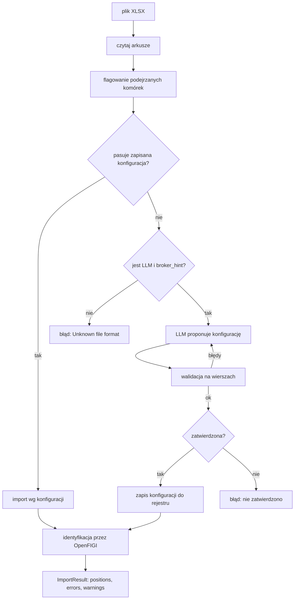

# P1 Portfolio X-Ray (`portfolio_xray`)

> Stan na 2026-10-23, commit `d0c43b4`. Opis sprawdzony w kodzie `src/fin_ai_lab/portfolio_xray/`. Specyfikacja: [docs/specs/p1-portfolio-xray/](../specs/p1-portfolio-xray/).

## Odpowiedzialność

P1 zamienia eksport z konta maklerskiego w jeden wspólny model portfela, liczy metryki i opisuje je krótkim raportem. Cel nauki: ustrukturyzowane odpowiedzi LLM, pętla samonaprawy, zabezpieczenia i testy odporności na wstrzyknięcie instrukcji.

Zasada przewodnia: **kod liczy, model tylko opisuje**. Każda liczba w raporcie pochodzi z kodu, a raport z liczbą spoza metryk jest odrzucany.

Moduł jest też podstawą aplikacji webowej: `portfolio_webapp` importuje stąd typy i funkcje portfela bezpośrednio (świadomy wyjątek od reguły "tylko przez `service.py`", opisany w [ARCHITECTURE.md](../ARCHITECTURE.md)).

## Układ

```
portfolio_xray/
├── canonical.py        model kanoniczny: Position, Portfolio, walidacja ISIN
├── service.py          publiczne wejście: import_file, import_bossa_csv, build_bossa_import_result
├── importer.py         import XLSX wg konfiguracji parsera, deduplikacja
├── ledger.py           import Bossa (CSV z transakcjami): odtworzenie pozycji z historii
├── parsers/            konfiguracje parserów, rejestr, pętla naprawy z LLM
├── identification/     OpenFIGI: ISIN lub ticker na FIGI i giełdę
├── privacy/            maskowanie danych osobowych, wykrywanie wstrzyknięć
├── metrics/            wagi i koncentracja, ryzyko, kursy walut, historia cen
├── sectors/            klasyfikacja sektora (LLM dla akcji)
├── report/             raport opisowy i kontrola wierności liczb
└── *_target.py         cele evali (import, wstrzyknięcia, raport, sektory)
```

## Model kanoniczny: `canonical.py`

`Position` to jedna pozycja w portfelu. Ważne pola:

| Pole | Znaczenie |
|---|---|
| `broker`, `account_type` | broker (dowolny niepusty tekst) i typ konta: `regular`, `ike`, `ikze`, `other` |
| `instrument_name`, `isin`, `symbol` | nazwa (1–200 znaków), ISIN (z kontrolą sumy), symbol brokera |
| `asset_class` | `equity`, `etf`, `bond`, `fund`, `cash`, `crypto`, `derivative`, `other` |
| `quantity`, `avg_cost`, `cost_currency` | ilość, średni koszt, waluta kosztu |
| `market_value`, `market_currency` | wartość rynkowa i waluta, **w której broker zapisał kwotę** |
| `quote_currency` | waluta notowań instrumentu (np. USD dla ETF-a w koncie PLN); służy do przeliczania cen Yahoo, nigdy nie opisuje zapisanej kwoty |
| `valuation_date` | data wyceny, nie może być z przyszłości |
| `resolution_status`, `figi`, `ticker`, `exchange_code`, `identification_rule` | wynik identyfikacji (OpenFIGI) |
| `suspicious_cells` | komórki wyglądające na instrukcję do modelu |

Walidacje: ilość różna od zera (ujemna tylko dla `derivative`), koszt i wartość nieujemne (wartość ujemna tylko dla `derivative`), przy podanym koszcie lub wartości waluta musi być znana (`PLN`, `USD`, `EUR`, `GBP`). Wszystkie kwoty to `Decimal`. `Portfolio` ma `positions`, `base_currency` (zawsze `PLN`) i `valuation_date`.

Różnica `market_currency` a `quote_currency` jest ważna i wraca w aplikacji webowej: XTB przelicza wartości sam (na walutę konta, per plik), a Bossa rozlicza wszystko w PLN, choć instrument notuje się gdzie indziej.

## Import: `service.py`

Dwie ścieżki, bo brokerzy eksportują różne rzeczy.



### `import_file` (XLSX, np. XTB)

1. `read_xlsx_sheets` wczytuje wszystkie arkusze, a `flag_suspicious_cells` oznacza komórki przypominające polecenie dla modelu. Flagi trafiają do `warnings`.
2. `find_matching_config` szuka zapisanej konfiguracji po sygnaturze nagłówków. Jeśli jest, `import_xlsx` buduje pozycje deterministycznie.
3. Jeśli nie ma, a podano klienta LLM, rejestr promptów, model i `broker_hint`, uruchamia się pętla naprawy (niżej). Nowa konfiguracja jest zapisywana dopiero po zatwierdzeniu przez wywołującego (`on_new_config_proposed`). CLI pyta interaktywnie.
4. Bez LLM nieznany format kończy się błędem `Unknown file format`.
5. Na końcu `_resolve_identifications` uzupełnia FIGI, ticker, giełdę i `quote_currency`.

### `import_bossa_csv` (Bossa, CSV z transakcjami)

Eksport Bossa to **lista transakcji**, nie migawka pozycji (kodowanie `cp1250`, separator `;`). Nie ma więc rejestru ani LLM. `ledger.py`:

- `parse_bossa_csv` czyta transakcje (`K` kupno, `S` sprzedaż, daty `dd.mm.rrrr gg:mm:ss`, liczby w formacie polskim),
- `transactions_to_positions` odtwarza pozycje deterministycznie. Ilość to bieżąca suma ze znakiem, średni koszt to średnia ważona zakupów (po prowizji), zmniejszana proporcjonalnie przy sprzedaży. Pozycje zamknięte do zera są pomijane. Pozycja ujemna to błąd ("luka w historii przed najwcześniejszą transakcją"),
- `attach_current_market_values` dopisuje wartość rynkową z cen Yahoo (eksport Bossa jej nie zawiera) i kursu NBP,
- `dedup_key` daje stabilną tożsamość wiersza transakcji, a `date_range` zakres dat pliku. Używa ich aplikacja webowa przy wielokrotnych importach.

`build_bossa_import_result` to ogon tego procesu (odtworzenie, identyfikacja, wartości), wydzielony, żeby aplikacja webowa mogła odtworzyć pozycje z pełnej zapisanej historii.

### Identyfikacja: `identification/openfigi.py`

`OpenFigiClient` (limit 25 żądań na minutę bez klucza, do 10 zadań na żądanie):

- `resolve_by_isin(isin, currency, broker_market)`: jedno notowanie w danej walucie daje `resolved`; kilka notowań rozstrzyga rynek brokera; w przeciwnym razie `ambiguous`; brak wyników to `unresolved`. W `identification_rule` zapisuje, którą regułą rozstrzygnięto,
- `resolve_by_ticker(ticker, exch_code)`: dla pozycji bez ISIN (XTB). Przyrostki XTB mapowane są na giełdy OpenFIGI (`UK`→`LN`, `PL`→`PW`, `US`→`US`, `NL`→`NA`), tylko te obserwowane w prawdziwych danych,
- `listings_by_isin`: wszystkie notowania wielu ISIN-ów w paczkach.

Gdy wyszukiwanie z walutą nic nie da, serwis ponawia je bez waluty (waluta zapisana przez brokera nie zawsze jest walutą notowań). Dla ISIN z prefiksem `US` rynek brokera zastępuje `US`.

### Pętla naprawy: `parsers/correction.py`

Dla nieznanego formatu LLM proponuje `ParserConfigProposal` (arkusz, wiersz nagłówka, filtr wierszy, mapowanie kolumn, formaty liczb i dat). Kolejne kroki:

1. Próbka (pierwsze 20 wierszy arkusza) jest **maskowana**: kolumny z nagłówkiem wyglądającym na dane osobowe (imię, nazwisko, PESEL, e-mail, rachunek, adres) dostają `[MASKED]` zamiast wartości.
2. Propozycja jest zamieniana na `ParserConfig`, uruchamiana na wszystkich wierszach i walidowana przez `build_position`.
3. Przy błędach model dostaje listę błędów i nieudanych wierszy i próbuje ponownie, maksymalnie `MAX_CORRECTION_ATTEMPTS = 2` poprawki (czyli 3 próby), potem `CorrectionLoopError`.

`ParserConfigProposal` ma mapowanie kolumn jako listę par, a nie słownik, bo darmowe API Gemini odrzuca w schemacie `additionalProperties`. Prompt: `parsers/prompts/propose_config.v2.md`.

### Rejestr parserów: `parsers/registry.py`

Konfiguracje to pliki YAML w `parsers/` (dziś `xtb_open_positions.v1.yaml`). Dopasowanie jest po **sygnaturze**: skrót SHA-256 znormalizowanych nagłówków, separatora, kodowania i nazwy arkusza. `save` zapisuje nową konfigurację jako **nowy plik z wyższą wersją** (nigdy nie nadpisuje istniejącego, żeby baseline'y evali były odtwarzalne). `currency_marker` w konfiguracji XTB wskazuje wiersz z walutą konta ("Open position value" i waluta 2 kolumny dalej), bo XTB podaje ją w metadanych arkusza.

### Importer XLSX: `importer.py`

`build_position` mapuje wiersz na `Position`. Kategorie XTB są tłumaczone na klasy aktywów (`ETF`→`etf`, `STOCK`/`STC`→`equity`, `CRYPTO`→`crypto`, `FX`/`CFD`→`derivative`, reszta→`other`); mapuje się tylko kategorie widziane w prawdziwych plikach. `deduplicate_positions` scala powtórzone pozycje i zwraca ostrzeżenia.

## Prywatność: `privacy/`

- `pii.py`: heurystyka po **nazwie nagłówka** (bez analizy wartości, żeby klasyfikacja była deterministyczna i łatwa do testowania).
- `injection.py`: wzorce typu "ignore previous instructions", "zignoruj poprzednie", "you are now", "system prompt", "nowe instrukcje:". Skanowanych jest każde pole, bez zgadywania, który wiersz jest nagłówkiem. Wynik to ostrzeżenie, a treść pliku i tak jest w promptach otoczona tagami jako dane.

## Metryki: `metrics/`

| Plik | Co liczy |
|---|---|
| `weights.py` | wagi pozycji, alokacja wg klasy aktywów, waluty i typu konta, HHI, efektywna liczba pozycji (`1/HHI`), udział 5 największych. Wszystko w `Decimal`. Błąd, gdy suma wartości nie jest dodatnia |
| `risk.py` | zmienność roczna (`std × √252`), VaR 95% 1-dniowy (historyczny), maksymalne obsunięcie, beta względem benchmarku. Liczone na bieżących wagach zastosowanych do przeszłych cen, tylko dla pozycji z co najmniej 250 sesjami historii. Pole `coverage` mówi, jaką część wagi portfela pokrywają te pozycje |
| `fx.py` | `NbpFxClient`: kurs średni NBP z tabeli A, potem B; cofanie do 7 dni; PLN to 1. Także szereg dzienny (`mid_rate_series`) |
| `price_history.py` | jedyne miejsce dotykające `yfinance` (nieoficjalne, bywa blokowane). Cache dzienny w `data/cache/prices/`. Funkcje: historia cen, dzienne zamknięcia, waluta notowań, dywidendy, tłumaczenie tickera OpenFIGI na symbol Yahoo (`to_yahoo_ticker`) |

## Sektory: `sectors/classifier.py`

Dla akcji (`equity`) LLM wybiera jeden z 10 sektorów w stylu GICS (Technology, Financials, Industrials, Healthcare, Energy, Materials, Consumer, Real Estate, Utilities, Communication); odpowiedź spoza listy to `other`. Dla pozostałych klas aktywów kategorią jest sama klasa (`etf`/`fund` jako `ETF/fund`). Prompt: `classify_sector.v1.md`.

## Raport: `report/`

`generate_report` (`orchestrator.py`) składa całość: import, przeliczenie wartości na PLN (NBP), wagi, historia cen i ryzyko (z opcjonalnym benchmarkiem), klasyfikacja sektorów, a potem `build_report`.

`build_report` (`builder.py`):

1. wysyła modelowi **tylko obliczone metryki** w JSON (prompt `narrative.v2.md`),
2. dopisuje stopkę edukacyjną ("analiza edukacyjna, nie rekomendacja inwestycyjna ... MiFID II"), jeśli model jej nie dodał,
3. `verify_numbers_faithful` wyciąga każdą liczbę z tekstu i sprawdza, czy występuje w metrykach (tolerancja względna 0,5%, minimalna bezwzględna 0,05). Numeracja nagłówków jest pomijana, a parametry metody (top-5, poziom 95%) są wartościami referencyjnymi,
4. rozbieżność oznacza `ReportRejectedError` z listą niezgodnych liczb.

Brak rekomendacji pilnuje [ADR-0006](../adr/0006-descriptive-reports-no-investment-advice.md), prompt i eval `p1-no-advice`.

## Cele evali

| Plik | Suita |
|---|---|
| `import_target.py` | `p1-import-accuracy` |
| `injection_target.py` | `p1-injection` |
| `report_target.py` | `p1-report-faithfulness`, `p1-no-advice` |
| `sector_target.py` | `p1-sector-accuracy` |

Baseline'y: `evals/baselines/p1-*.json`.

## Uruchamianie

```bash
uv run fin-ai-lab portfolio import <plik>
uv run fin-ai-lab portfolio report <plik>
```

Szczegóły opcji w [OPERATIONS.md](../OPERATIONS.md). Wymaga extra `portfolio` (`numpy`, `pandas`, `yfinance`); `openpyxl` należy do rdzenia. Prawdziwe eksporty trzymaj w `data/private/` (poza gitem).

## Testy

`tests/portfolio_xray/` (`parsers`, `identification`, `metrics`, `privacy`, `report`, `sectors`, plus `test_importer.py`, `test_ledger.py`, `test_service.py`, `test_canonical.py`). Dane testowe są syntetyczne (`_fixtures.py`).

## Znane ograniczenia

- Mapowanie klas aktywów i giełd obejmuje tylko to, co zaobserwowano w prawdziwych plikach; reszta trafia do `other` lub zostaje nierozpoznana.
- Ryzyko używa bieżących wag na historycznych cenach i nie obejmuje pozycji bez historii (stąd pole `coverage`).
- Eksport Bossa nie niesie typu instrumentu, więc klasa aktywów to `other`.
- Dane z `yfinance` są nieoficjalne i tylko do użytku lokalnego (licencje: [DATA-SOURCES.md](../DATA-SOURCES.md)).
